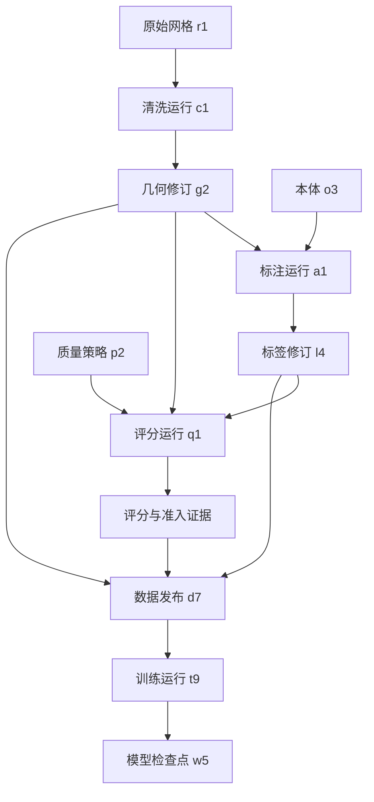

# 第二十一讲：Data Versioning & Data Lineage
## 数据版本管理与血缘追踪：让每次训练的数据都能被解释、核验和恢复

这一讲承接第 20 讲的质量评分。上一讲回答“这份资产为什么可以进入数据集”，这一讲要进一步回答：

> **哪一个资产版本，在什么标签体系、检查器和筛选规则下，被放进了哪一份数据集，又被哪一次训练使用？**

学完后，你应能设计一个可追溯的数据发布清单，识别几何与标签错配，定位一次规则变更的下游影响，并解释“保存了版本”与“能够复现结果”的差别。

本讲按 **概念 → 原理 → 数据结构 → 算法 → 工程实现 → 评价指标 → 实际案例 → 面试追问 → 小测** 展开。除注明的本次代码执行结果，案例、编号和业务数字均为教学设定，不是用户项目或腾讯内部实测。

---

## 一、概念：我们究竟在给什么做版本管理？

### 1.1 从一个具体事故开始

假设你维护一个椅子部件分割数据集：

1. 昨天使用 2,000 个网格训练，效果正常。
2. 今天更新了清洗工具，重新导出了部分网格。
3. 标注文件没有更新，因为“面数没变”。
4. 同时，把质量筛选阈值从 80 改成了 85。
5. 晚上模型对椅腿的分割变差了。

这时，“今天的数据有问题”没有提供足够的信息。你需要查清：

- 哪些网格的字节、面顺序或坐标发生了变化？
- 标签对应的是导出前还是导出后的网格？
- 入选样本变了，还是同一批样本的内容变了？
- 质量阈值、标注本体、划分规则各用了哪个版本？
- 哪些训练任务读到了这次更新？

**版本管理让当时的数据状态能够被确定；血缘追踪让状态之间的产生和使用关系能够被追查。**

### 1.2 六个基本概念

| 概念 | 中文解释 | 在 3D 数据中的例子 |
|---|---|---|
| Data Versioning | 数据版本管理：保存、标识、比较和恢复明确的数据状态 | 椅子几何修订 r3、部件标签 a2 |
| Snapshot | 快照：某一时刻被固定的数据集合及依赖引用 | 某次训练实际使用的 2,000 个样本 |
| Manifest | 清单：描述快照包含什么、引用什么版本的结构化文件 | 每条样本的网格、标签、split、校验值 |
| Provenance | 来源与产生证据 | 采集来源、制作活动、责任主体、处理记录 |
| Data Lineage | 数据血缘：数据经过变换及被下游使用的关系 | 原始扫描 → 清洗网格 → 标签 → 训练集 |
| Release | 发布：经过验收、可供下游消费的明确版本 | `chair-parts-1.1.0` |

“每天复制一份文件夹”可以提供备份，但如果没有明确成员、版本绑定和处理关系，仍然很难回答上面的事故问题。

“保存日志”也不自动等于血缘：日志中的 `input=chair.obj` 没有说明究竟是哪一份内容。

### 1.3 最容易混淆的七种身份

| 标识 | 回答的问题 | 是否会随变化而改变？ |
|---|---|---|
| `asset_id` | 这是哪一个逻辑资产？ | 同一椅子的连续修订通常保持不变 |
| `asset_family_id` | 哪些数据来自同一身份或派生家族？ | 按版本化分组规则维护 |
| `artifact_hash` | 这份文件的确切字节是什么？ | 字节改变，摘要通常改变 |
| `revision_id` | 这个资产的哪一个不可变状态？ | 几何、标签或相关状态改变时生成新修订 |
| `recipe_id` | 使用什么输入和计算配方？ | 输入、代码、配置等改变时改变 |
| `run_id` | 具体是哪一次执行？ | 每次真实执行分别记录 |
| `release_id` | 下游使用哪一份发布快照？ | 发布内容或受版本管理的依赖改变时改变 |

这里的具体命名是本课程的工程建议，不是某个标准强制规定的字段。

**同一文件可以被两个来源提交。**它们的内容摘要相同，物理存储可以复用，但来源、采集记录与可用范围不能因此被合并丢失。

**同一椅子也可以有不同文件摘要。**转换格式、改变压缩、重排顶点，都可能改变字节；这些文件仍可能属于同一家族。

所以，第 18 讲的几何近重复判断、这里的内容完整性检查，以及资产身份管理，要分别维护。

---

## 二、原理：不可变内容、版本依赖与可复现性

### 2.1 内容摘要：固定“这些字节”

对于文件字节序列 \(B\)，定义：

\[
h_B=\operatorname{SHA256}(B)
\]

\(B\) 是文件完整字节；\(h_B\) 是 256 位摘要，通常写成 64 个十六进制字符。摘要没有几何单位。

在通常的工程完整性校验中，我们把摘要一致作为内容一致的强证据；哈希碰撞在数学上仍然可能，因此不把它说成绝对的一一映射。

它可以检查：

- 文件是否被意外修改；
- 下载是否得到预期内容；
- 同一对象是否已经存储；
- 某个发布引用的是否仍是原来的文件。

它不能单独证明：

- 这个模型是同一现实物体；
- 两个网格几何等价；
- 标签是正确的；
- 来源记录可信；
- 文件现在还取得到。

如果文件与清单都被一起替换，单纯重新计算哈希也无法证明历史真实性。可信发布记录、访问控制和必要的签名属于另一层保障。

### 2.2 不可变：修改产生新对象

推荐的约束是：

> 已发布对象的内容保持不变；更新通过创建新对象、新修订和新发布来表达。

例如，`geometry_r1` 修复后产生 `geometry_r2`。旧训练仍然引用 r1，新训练可以选择 r2。

这不要求每次复制全部资产。若 100 GB 数据中只改变了一个 10 MB 文件，未改变的对象可以在多个快照间共享；具体存储增量还取决于文件或分块粒度、压缩和元数据开销。

内容存储路径可以使用摘要；供人阅读的“版本名”则映射到确定的清单。**训练记录应保存已经解析出的不可变标识，不能只留下会变化的 `latest`。**

lakeFS 的官方数据模型同样区分不可变提交与会推进的分支引用。[R2] genui{"citation":{"ref":"turn429208289view0"}}

### 2.3 给清单计算摘要前，先确定序列化规则

下面两段 JSON 对象表达相同的键值映射，但原始字节不同：

```json
{"asset_id":"chair-7","split":"train"}
```

```json
{"split":"train", "asset_id":"chair-7"}
```

如果希望同一逻辑清单稳定得到同一摘要，就要约定：

1. 字符编码；
2. 字段排序；
3. 空格和换行；
4. 数字表示；
5. 哪些列表有顺序意义；
6. 哪些字段参与内容身份。

例如，成员集合可以按稳定的 `record_id` 排序；网格面数组和标签数组具有索引意义，不能为了“稳定哈希”随意排序。

跨语言系统可以采用明确的规范化方案。RFC 8785 的 JSON Canonicalization Scheme（JCS）规定了相关序列化与属性排序规则；Python 的 `sort_keys=True` 本身不等于完整实现 JCS。[R3] genui{"citation":{"ref":"turn551380555view1"}}

### 2.4 一个数据集版本是一组相互绑定的版本

对部件分割任务，可以把发布状态写为：

\[
D_v=
\left(
M_v,\,
O_v,\,
Q_v,\,
T_v,\,
S_v,\,
P_v
\right)
\]

其中：

- \(M_v\)：实际入选样本清单，包含几何和标签的确切引用；
- \(O_v\)：标注本体版本，例如 `leg` 的定义；
- \(Q_v\)：检查器、评分规则及必要的校准器版本；
- \(T_v\)：任务配置，例如分类还是部件分割；
- \(S_v\)：实际数据划分及资产家族分组版本；
- \(P_v\)：产生这次发布的处理配方和来源证据引用。

这些是结构化对象或引用，没有物理单位。

**仅仅改了权重、阈值或缺失值处理，也可能改变数据集版本。**网格没变，不代表“这个数据集为什么包含这些网格”的依据没变。

甚至入选名单恰好没有改变，也应保存新的决策记录。实践中可以分别维护“样本内容快照”和“含策略证据的发布快照”，清楚说明各自摘要覆盖哪些字段。

### 2.5 依赖闭包：清单中的对象能否完整取回？

假设一个发布引用网格，网格还引用纹理，标签还引用本体。仅检查最外层清单存在是不够的。

记：

\[
\operatorname{Closure}(D)
\]

为按照本系统声明的依赖边，从发布 \(D\) 递归访问到的全部必需对象集合。

发布前应验证：闭包中的必需对象都可取得，摘要符合预期，关联关系通过检查。

这里有一个边界：**系统只能遍历已声明的依赖。**漏报了一张纹理、一个私有预处理脚本或一个外部数据库状态，遍历程序无法凭空发现它。因此，依赖声明本身也需要审核。

### 2.6 血缘中的三个角色

W3C PROV 用 Entity、Activity、Agent 描述实体、活动和责任主体，并提供使用、生成、派生等关系。[R1] genui{"citation":{"ref":"turn360235377view0"}}

在我们的课程中：

- **实体 Entity**：一个确定的原始网格、标签修订或发布快照；
- **活动 Activity**：一次清洗、标注、评分或训练；
- **责任主体 Agent**：执行或负责该活动的人、程序或组织；这里不是专指大语言模型 Agent。

下面展示一个简化的处理血缘。代码、参数和环境还需绑定到相应活动，图中省略以保持可读。



本讲把**具体修订之间的计算依赖**组织为有向无环图（Directed Acyclic Graph，DAG）。这是一项设计约束，不意味着所有 PROV 关系天然都只能构成 DAG。

为什么不直接把所有节点设成文件摘要？因为一次“检查但不修改”的运行，输入和输出可能字节相同。若把内容存储身份和处理活动身份混为一谈，就可能错误地产生自环。

### 2.7 保存版本，不等于保证 GPU 训练逐位重现

至少区分四种能力：

| 能力 | 需要证明什么？ |
|---|---|
| 可定位 | 知道当时使用了哪些对象和配置 |
| 可恢复 | 能取得这些对象，且字节摘要一致 |
| 可重执行 | 程序、依赖、参数、必要服务仍可用 |
| 结果可复现 | 重执行结果满足预先声明的一致性标准 |

“一致性标准”可以是逐字节相同，也可以是规定容差内的数值一致，或者多次运行下符合统计验收协议。三者不能混写。

PyTorch 官方明确说明，相同随机种子不能保证跨版本、平台或 CPU/GPU 执行的完全一致。[R4] genui{"citation":{"ref":"turn429208289view1"}}

因此，记录种子之外，还应保存软件环境、代码状态、数据加载顺序、模型权重和必要的硬件/算法配置；对关键中间结果直接保留实际产物。

---

## 三、数据结构：怎样设计能长期维护的记录？

### 3.1 建议分成四类记录

| 记录 | 主要字段 | 负责解释什么？ |
|---|---|---|
| 对象登记 Artifact | hash、size、media_type、storage_locator | 文件是什么、到哪里取 |
| 资产与标注修订 Revision | asset_id、geometry_ref、annotation_ref、ontology_ref | 这个资产当前具体状态 |
| 运行记录 Run | run_id、recipe_id、inputs、outputs、code、environment、status | 哪次操作产生了什么 |
| 发布清单 Release Manifest | members、policy_ref、split_ref、schema_version | 下游固定使用哪份集合 |

其中：

- `storage_locator` 是位置，不是身份；迁移存储后位置可以变化。
- `schema_version` 是记录结构的版本，不是资产内容版本。
- 人类可读的 `v1.2.0` 是发布名称，不能替代校验值。
- `run_id` 对应执行事件，时间、耗时和操作人放在这里；不要把每次变化的时间随意混入希望稳定复用的内容身份。

对大型网格，还要记录单位、坐标约定、轴向、变换矩阵约定、纹理依赖、图元/子网格定位方式。否则文件能打开，仍可能被错误解释。

### 3.2 面级标签必须绑定确切网格

设：

\[
F=[f_0,f_1,\ldots,f_{m-1}]
\]

是有序面数组，\(L[i]\) 表示第 \(i\) 个面的类别。

如果新网格只是重新排列：

\[
F_{\mathrm{new}}[j]=F_{\mathrm{old}}[p(j)]
\]

那么相应标签必须满足：

\[
L_{\mathrm{new}}[j]=L_{\mathrm{old}}[p(j)]
\]

\(p\) 是索引置换，\(m\) 是面数；索引和类别编号都没有物理单位。

例如：

```text
原面顺序： [椅面, 椅腿]
原标签：   [seat, leg]

新面顺序： [椅腿, 椅面]
正确标签： [leg, seat]
```

面数仍然是 2，标签长度也仍然是 2，但直接沿用原标签就错了。

推荐至少绑定：

```json
{
  "annotation_id": "chair-7-parts-a4",
  "asset_id": "chair-7",
  "geometry_sha256": "<exact mesh digest>",
  "primitive_id": "mesh0/primitive0",
  "granularity": "face",
  "index_basis": "stored_face_order",
  "element_count": 2,
  "ontology_ref": "<ontology digest>",
  "labels": [3, 1],
  "review_status": "approved"
}
```

这是字段示例，尖括号内为占位说明，不能当成已存在的摘要使用。

精确文件摘要是一种保守绑定。如果只是无关元数据改变，也会触发不匹配；生产系统可以额外定义几何和索引顺序的指纹来证明兼容，但不能用“看起来一样”绕过验证。

重拓扑、简化、切割通常不再是简单排列。必须创建标签转移活动，保留对应关系或投影算法，并重新审核边界、不确定区域与覆盖率。

同一原则适用于：

- 点级标签与点顺序；
- 顶点蒙皮权重与顶点、骨骼索引；
- Face Corner UV 与角点索引；
- BlendShape 位移与基础网格顶点顺序。

### 3.3 发布清单示例

下面展示更接近实际系统的结构；真实实验使用较小的同类 schema。

```json
{
  "schema_version": "dataset-release/1",
  "dataset_name": "chair-parts",
  "task_profile_ref": "<task profile digest>",
  "ontology_ref": "<ontology digest>",
  "quality_policy_ref": "<quality policy digest>",
  "family_registry_ref": "<grouping registry digest>",
  "split_spec_ref": "<split specification digest>",
  "members": [
    {
      "record_id": "chair-7/main",
      "asset_id": "chair-7",
      "asset_family_id": "chair-family-7",
      "geometry_ref": "<mesh digest>",
      "annotation_ref": "<annotation digest>",
      "quality_evidence_ref": "<decision evidence digest>",
      "split": "train"
    }
  ],
  "build_recipe_ref": "<build recipe digest>"
}
```

几个容易遗漏的要求：

**第一，保存实际成员。**`SELECT ... WHERE score >= 85` 是筛选配方；它查询的表会变，不能替代当时选中的清单。

**第二，保存 split 的结果。**只有随机种子不够：候选名单、排序、分组算法或库版本变化，都可能改变划分。

**第三，保存分组的版本。**后来发现两个原本不同的家族其实来自同一资产，要新增分组修订，并检查旧评测是否已经存在泄漏。

**第四，检查成员唯一性。**同一逻辑资产可能有多个视图或表示，因此选择一个定义明确的 `record_id`，不要默认 `asset_id` 在所有任务中都只出现一次。

### 3.4 运行记录应保留“意图”和“事实”

配方记录用于表达预期计算：

```text
operation + exact inputs + code identity + parameters
+ environment identity + relevant random seeds
```

运行记录用于表达实际执行：

```text
run_id + recipe_id + actual inputs/outputs
+ start/end + actor + status + error/evidence
```

同一配方运行两次，可能得到相同输出，也可能因未控制的随机性得到不同输出。两种情况都要记录实际输出摘要。

如果代码工作区有未提交改动，仅保存 Git 提交号不够；需要保存实际执行源码或补丁摘要，并明确其可恢复位置。

---

## 四、算法：发布、比较、追查和回滚怎么做？

### 4.1 发布算法：先完成候选，再切换入口

一个基本发布流程如下：

1. **固定候选输入。**解析当前资产、标签、本体、任务与规则的确切引用。
2. **校验记录结构。**必需字段缺失属于失败，不能当作默认通过。
3. **验证文件。**取得依赖对象，重新计算摘要，检查大小和格式。
4. **验证关联。**标签绑定、粒度、元素数量、本体类别和值域相互一致。
5. **执行任务门禁。**使用固定策略，保留原始测量、决策和理由。
6. **冻结成员与划分。**检查重复 record、家族跨集合与不允许的派生关系。
7. **保存候选清单。**写入不可变对象，并计算发布内容标识。
8. **生成差异和验收报告。**说明增加、移除、修改及策略变化。
9. **发布。**全部成功后才更新当前发布引用。
10. **记录事件。**保存谁、什么时候、基于哪份验证结果进行了发布。

核心顺序是：**对象与清单完整就绪 → 验证通过 → 当前引用切换。**

如果第 6 步失败，下游仍然读取旧的有效发布，不能看到半成品。

并发写入时，还需要比较并交换（Compare-and-Set，CAS）或事务：只有当前引用仍等于任务开始时观察到的版本，才允许推进。lakeFS 的并发提交设计也采用条件更新解决类似问题。[R2] genui{"citation":{"ref":"turn429208289view0"}}

注意两个不同的 CAS 缩写：

- **Content-Addressable Storage**：内容寻址存储；
- **Compare-and-Set**：比较并交换。

它们解决的是不同问题。

### 4.2 差异比较：不能只看样本数量

设旧、新发布的样本键集合分别为 \(A,B\)：

\[
\begin{aligned}
\mathrm{Added} &= B\setminus A\\
\mathrm{Removed} &= A\setminus B\\
\mathrm{Changed} &=
\{k\in A\cap B\mid \mathrm{record}_A(k)\ne\mathrm{record}_B(k)\}
\end{aligned}
\]

样本数都为 2,000，仍然可能全部内容已经变化。

建议分别报告：

- 几何变化；
- 标签与本体变化；
- 质量证据及准入理由变化；
- split 或家族归属变化；
- 策略、任务配置及运行环境变化。

比较平均质量分时，也要检查评分策略是否相同。两套规则算出的 90 分，不能直接解释成同一种质量水平。

如果清单按稳定键排序，可以用线性归并比较；未排序时，哈希映射比较通常需要 \(O(n+m)\) 的预期时间和相应内存。这里的 \(n,m\) 是两份清单的记录数。

### 4.3 增量重算：由真实依赖决定

可以为一次计算定义配方键：

\[
K=H\!\left(
\operatorname{Serialize}(
\text{operation},
\text{inputs},
\text{code},
\text{parameters},
\text{environment}
)\right)
\]

\(H\) 是哈希函数；Serialize 使用已声明的确定性规则。输入依赖如果按角色区分，序列化也必须保留角色；不能把有顺序含义的输入任意排序。

| 变化 | 通常需要重算 | 满足明确依赖条件时可复用 |
|---|---|---|
| 质量阈值改变 | 准入决策、发布清单 | 原始几何检测值 |
| 面标签修正 | 标注检查、相关评分、训练数据 | 未变化的网格文件 |
| 面索引重排 | 标签绑定与转移、索引相关缓存 | 经证明与索引无关的结果 |
| 拓扑修复或重拓扑 | 几何检查、标签转移、相关派生 | 不受影响的来源记录 |
| 本体类别合并 | 标签映射、统计和任务输出定义 | 适用范围内的原始几何 |

这里的“可复用”必须由依赖契约支持。

如果某个阶段偷偷读取 `latest_model.pt`，但缓存键里没有对应权重摘要，就可能错误复用旧结果。**缓存命中不是结果正确的证明。**

DVC 的 `dvc.lock` 会保存阶段依赖、输出内容校验值和参数实际值，帮助跟踪这些关系；它仍依赖用户完整声明计算依赖。[R5] genui{"citation":{"ref":"turn551380555view4"}}

### 4.4 影响追踪：从问题对象找下游

假设发现 `annotation_a4` 有错误。建立“上游 → 下游”的邻接表后，用广度优先搜索或深度优先搜索访问后代，可以找出：

- 使用该标签的评分记录；
- 包含它的数据发布；
- 使用这些发布的训练运行；
- 由这些运行生成的检查点与报告。

若访问的图包含 \(V\) 个节点、\(E\) 条边，遍历复杂度为 \(O(V+E)\)。需维护 visited，防止重复访问；导入记录时还应检查悬空引用与不允许的循环。

但“依赖了错误标签”只表示**可能受影响**，不证明某次指标下降完全由它造成。归因还需要对照实验和分层分析。

### 4.5 回滚、停用和删除分别处理

| 操作 | 改变什么？ | 不自动完成什么？ |
|---|---|---|
| 回滚 Rollback | 当前发布引用指向旧的有效快照 | 不撤销已经完成的训练 |
| 停用/撤销使用 | 某对象或发布不再供新的任务采用 | 不自动清除所有副本 |
| 删除 Delete | 物理删除指定对象或副本 | 不自动移除其对已训练模型的影响 |

旧版本有问题时，应保留问题记录和修复关系；需要清除数据时，则按独立的保留与删除流程处理，不能把“不可变”理解为“永远不能删除”。

如果某个源已被停用，回滚入口还要检查旧发布是否继续引用它。**不是越旧的版本就越安全。**

存储清理也不能只看“当前版本未引用”：历史保留版本、活动训练、运行记录或待审核候选可能仍然需要这些对象。

---

## 五、工程实现：构建一个最小版本与血缘实验

### 5.1 实验范围

配套实验使用 **Python 3.10+ 和标准库**，无需 GPU、Blender、数据库或第三方 Python 包。

输入是两个明确生成的微型网格，每个包含两个三角面；采用右手坐标系、Z 向上、单位米。实验坐标为整数，JSON 序列化只支持所声明的类型并拒绝浮点数。它们只用于验证数据管理逻辑，不是几何质量或真实训练 Benchmark。

完整代码、输入构造和结果保存在：

- [versioning_lineage_lab.py](https://github.com/lucinwen/3d/blob/main/examples/lesson21/versioning_lineage_lab.py)
- [实验 README](https://github.com/lucinwen/3d/blob/main/examples/lesson21/README.md)
- [example-report.json](https://github.com/lucinwen/3d/blob/main/examples/lesson21/example-report.json)

### 5.2 运行方法

从课程仓库根目录运行：

```bash
python examples/lesson21/versioning_lineage_lab.py --output examples/lesson21/example-report.json
```

实验不是只打印“发布成功”，而是主动制造错误，验证错误是否被挡住。

**下面是脚本中的发布函数原文。**它依赖同文件的校验器和序列化函数，需与完整脚本一起运行：

```python
def publish(store, release, opaque_hashes):
    cid, closure, edges = validate_release(store, release, opaque_hashes)
    current = store.root / "current.json"
    # Single-writer demo: same-filesystem rename exposes a whole pointer file.
    with tempfile.NamedTemporaryFile(dir=store.root, delete=False) as file:
        staged = Path(file.name)
        file.write(canonical_bytes({"release_hash": cid}))
        file.flush()
        os.fsync(file.fileno())
    try:
        os.replace(staged, current)
    finally:
        staged.unlink(missing_ok=True)
    return cid, closure, edges
```

先看第一行：完整校验发生在指针切换之前。只要验证抛出错误，后面的替换就不会发生。

**本次实际运行结果：Python 3.12.14，退出码 0。**整合时又独立复跑一次，发布清单与配方标识一致；报告中的运行 UUID 随新执行而变化。完整标准输出与保存的 JSON 报告逐字一致。

| 实验观察 | 本次结果 |
|---|---|
| 合成输入 | 2 个资产，共 4 个三角面 |
| 不同发布快照 | 2 个 |
| 每份发布的依赖闭包 | 11 个对象，包含发布清单本身 |
| 两份有效发布合并的去重依赖边 | 40 条 |
| 网格 A 的下游对象 | 5 个：1 份标签、2 个配方、2 份发布 |
| 相同配置再次执行 | 相同发布内容标识，不同 run UUID |
| 回滚 | 恢复第一份发布引用，两份发布对象仍保留 |

七项实际故障注入如下：

| 注入的故障 | 实际阻断原因 |
|---|---|
| 样本缺少家族字段 | `missing_sample_fields` |
| 同一家族跨训练与测试集 | `family_split_leakage` |
| 面数不变但面顺序改变，沿用旧标签 | `annotation_mesh_binding_mismatch` |
| 引用了不存在的来源对象 | `missing_object` |
| 配方漏记实际输入 | `recipe_input_or_config_mismatch` |
| 发布本体改变，标签仍绑定旧本体 | `annotation_ontology_mismatch` |
| 文件字节被直接破坏 | `hash_mismatch` |

七种错误均被挡住，每次失败后的当前发布指针都保持不变。执行证据保存在 [execution-verification.json](https://github.com/lucinwen/3d/blob/main/archive/lessons/21/execution-verification.json)。

实验中，质量阈值从 80 改为 85 **只用于演示策略身份变化**；没有实际质量评分，也没有根据阈值删除样本。

另外，实验实现的是**内容对象依赖图**，没有记录源文件到规范网格的实际转换活动，也不是完整的 Entity/Activity/Agent 生产血缘系统；运行记录另行保存。临时对象库在运行结束后清理，交付的是可重建实验的代码和完整报告，不是一个已部署的对象服务。

### 5.3 为什么这些检查有价值？

**第一类：内容变化。**文件路径不变但内容被改，摘要检查应发现。

**第二类：关系错误。**网格和标签各自都是合法文件，但彼此不匹配；这只能靠绑定检查发现。

**第三类：集合错误。**每条样本单独都合法，但同一家族进入训练与测试；这只能靠集合级检查发现。

**第四类：发布错误。**候选数据有问题时，不能把当前可用版本一起破坏。

这四类错误说明：单文件校验、样本关联校验、数据集校验与发布一致性，分别承担不同职责。

### 5.4 从实验到实际系统，还需要什么？

本实验的对象库是本地单写者教学实现。不能把一次文件替换解释为已经实现跨进程事务、并发 CAS、断电持久性或分布式存储一致性。

生产化还需要：

- 大文件流式哈希与上传，避免全部读入内存；
- 完整的几何、标签与本体 schema 验证；
- 可恢复的失败状态、访问控制及审核事件；
- 多写者并发控制；
- 远端对象可用性、备份和恢复演练；
- 任务级依赖与训练运行的真实接入；
- 明确的对象保留、停用与清理策略。

**实验通过，只证明被实现并执行的这些行为；不等于真实模型训练已完成复现。**

### 5.5 Git、DVC、lakeFS、MLflow 如何分工？

| 工具或层 | 适合管理什么？ | 使用时仍要保证什么？ |
|---|---|---|
| Git | 代码、schema、配置、小型清单、文档 | 真正执行的代码与记录一致 |
| Git LFS | 用 Git 中的指针追踪大文件 | 指针指向的对象实际可取回 |
| 对象存储 | 网格、纹理、点云、权重等大对象 | 身份、摘要、保留、访问与恢复 |
| DVC | 数据文件、管线依赖、参数及输出状态 | 依赖声明完整，远端对象可用 |
| lakeFS | 对象集合的提交、分支和版本读取 | 业务标签绑定与质量规则正确 |
| MLflow | 训练运行、输入元数据、参数、指标与模型关联 | 实际训练快照及变换被准确记录 |

Git LFS 在仓库中保存的是指针，实际大文件存放在其他位置。因此，“提交了指针”不等于“验证了资产已经备份”。[R6] genui{"citation":{"ref":"turn360235377view5"}}

MLflow 的官方 API 也指出，经过筛选或变换后的数据特征与目标可以不同于原始 Source。记录源 URL 后，仍需明确实际训练输入。[R7] genui{"citation":{"ref":"turn551380555view0"}}

对当前课程，先掌握清单、摘要、绑定、运行记录与发布契约即可。选用工具之后，这些要求依然存在。

---

## 六、评价指标：怎样证明版本系统确实可靠？

### 6.1 对象恢复率与内容完整率

对某个发布依赖闭包中的 \(N\) 个必需对象，设：

- \(N_{\mathrm{fetch}}\)：实际能够取回的对象数；
- \(N_{\mathrm{match}}\)：成功取回且摘要匹配的对象数。

定义：

\[
R_{\mathrm{fetch}}=\frac{N_{\mathrm{fetch}}}{N},
\qquad
R_{\mathrm{integrity}}=\frac{N_{\mathrm{match}}}{N}
\]

两者范围为 \([0,1]\)，越高越好。

完整率的分母包含所有必需对象，不能先删掉取不回来的对象，再对剩余对象报告“100% 正确”。

关键依赖的任何缺失，都可能使发布不可用；高平均比例不能替代发布门禁。若 \(N=0\)，应报告不适用或配置错误，不能默认 100%。

### 6.2 标签绑定有效率

\[
R_{\mathrm{binding}}
=
\frac{\text{通过规定绑定检查的样本数}}
{\text{需要标签绑定的样本数}}
\]

协议至少说明检查了哪些关系：几何摘要、图元、粒度、数量、本体、标签值域等。

“数组长度一致率”只是其中一个子检查，不能命名为完整的标签正确率。绑定正确也不代表人工标注的语义一定正确。

### 6.3 血缘完整度

可以在独立审核的运行样本中计算：

\[
R_{\mathrm{lineage}}
=
\frac{\text{拥有全部必需输入、输出、配方及责任记录的运行数}}
{\text{被审核的运行总数}}
\]

关键是先定义“全部必需记录”，并检查真实依赖。

只对数据库里已经存在的边计数，不能证明没有漏记边。对于不可取得的来源或外部依赖，应如实标注未知或缺失。

### 6.4 数据划分隔离

对分组表中每个家族 \(g\)，定义它出现的 split 集合：

\[
S(g)=\{\text{该家族样本出现的 split}\}
\]

若任务要求家族隔离，那么出现 \(|S(g)|>1\) 的家族就是跨集合冲突。

可报告：

\[
N_{\mathrm{cross}}
=
|\{g:|S(g)|>1\}|
\]

以及受影响样本数、家族数和所依据的分组版本。

\(N_{\mathrm{cross}}=0\) 只说明**已知分组关系**下没有冲突；未知的近重复、同一实物多次扫描或错误家族登记仍可能导致泄漏。第 22 讲会深入讨论这种划分设计。

### 6.5 重建一致率与回滚恢复时间

对声明“应逐字节确定”的阶段：

\[
R_{\mathrm{rebuild}}
=
\frac{\text{重新计算后输出摘要一致的阶段数}}
{\text{实际重执行的适用阶段数}}
\]

非确定性训练应另设容差或统计协议，不能把不同检查点摘要直接解释为模型不可用。

回滚恢复时间则从“决定恢复某个版本”计到“下游能读取并验证该版本”。它不仅包括修改指针，还包括对象恢复、缓存一致性和下游验证。

指标报告必须说明：

- 全量还是抽样；
- 审核范围与样本数；
- 本地还是远端；
- 冷缓存还是热缓存；
- 是否实际重执行；
- 未覆盖的故障类型。

一次本地演示成功，不能推导出生产环境的可用性承诺。

---

## 七、实际案例：排查一次 3D 部件数据更新事故

以下继续采用教学假设：一个椅子部件分割项目，训练集 2,000 个样本，固定测试集 400 个样本。

### 7.1 初始发布

`release_A` 固定：

- 几何清单 G1；
- 标注修订集合 A1；
- 本体 O1；
- 评分策略 Q1；
- 家族分组 F1；
- 划分 S1；
- 训练运行 T1。

这使我们能够确定“旧模型实际上吃了什么数据”。

### 7.2 一次更新包含三类变化

| 更新 | 表面上看 | 实际需要保存和检查 |
|---|---|---|
| 导出器重排了 100 个网格的面 | 模型外观看起来一样 | 新网格摘要、排列映射、标签转移和验证 |
| 将某类支撑结构从 leg 改为 support | 只是标签文字改动 | 本体定义、编号映射和迁移记录 |
| 质量阈值从 80 改为 85 | 只是一个参数 | 规则版本、准入变化、类别保留率 |

这些变化不能合并成一句“更新了数据集”。

第一项需要验证索引；第二项可能改变任务标签语义；第三项可能改变训练分布。它们影响的范围不同。

### 7.3 发现效果下降后的排查顺序

**第一步：固定比较对象。**确认旧、新模型是在同一测试输入、本体与评测协议下比较。如果测试标签也改了，应单独说明，不能直接把两个指标当作同一标尺。

**第二步：查看 manifest diff。**区分样本增删、同一记录内容变化、策略变化和 split 变化。

**第三步：检查硬性不变量。**先排除标签错绑、缺失对象、无效类别编号和家族泄漏。这些问题不需要先训练更多模型才能发现。

**第四步：追查依赖。**从有问题的网格或标签查到受影响发布、训练任务和报告。

**第五步：进行有控制的比较。**例如固定模型、测试集与训练协议，分别比较：

- 只修正标签绑定；
- 只调整质量阈值；
- 两者同时更新。

若训练本身有明显随机波动，还需要多次运行或合适的统计比较。单次指标改善不足以证明因果。

### 7.4 正确恢复

如果新发布存在错绑：

1. 停用有问题的发布入口；
2. 确认旧发布仍符合当前使用要求；
3. 将后续任务指向旧发布；
4. 标记已使用问题数据的运行和报告；
5. 修复产生新版本；
6. 重新验收后再发布。

已经训练出的模型不会因为数据指针回滚而自动“恢复”。是否重训，取决于问题范围、风险和验证结果。

### 7.5 怎样写一份让其他 AI 能接续的变更记录？

建议明确写：

```text
变更对象：chair-7 的几何修订与面标签
原因：导出器改变面顺序，旧标签绑定失效
输入：旧网格摘要、旧标签摘要、本体版本
处理：按显式面置换转移标签
输出：新网格摘要、新标签摘要
验证：摘要、元素数、绑定、本体值域与抽检
影响：包含该样本的发布及使用这些发布的训练
处置：停用问题发布，生成新候选并复验
```

这比“已优化数据质量”更能支持复查和协作。

对于本课程本身，也采用相同原则：保留完整教学源、代码、实际执行报告、来源及交接记录；当前新编材料不被描述为已经恢复的历史聊天原文。

---

## 八、面试追问：从定义到系统设计

### Q1：Git 已经有版本管理，为什么还要做数据版本管理？

**参考回答：**Git 能管理代码、配置和清单的历史，但一次训练还依赖大资产、标签、本体、数据划分和远端对象。需要把这些对象与 Git 中的配置绑定到明确快照，并验证能够取回。

**追问：用了 Git LFS 就完成了吗？**

没有。还要验证大文件对象存在、标签关联正确、成员清单固定，并记录产生和使用它们的运行。

### Q2：SHA-256 能不能作为 asset_id？

**参考回答：**可以用来标识确切内容，但不适合作为唯一的逻辑资产身份。同一资产修订后摘要改变；不同来源可能提交相同字节。应分开维护逻辑资产、内容摘要和来源记录。

**追问：两个文件摘要不同，是否就不重复？**

不是。重新编码、格式转换或索引重排都可能改变字节；几何近重复需要另行判断。

### Q3：面数没变，为什么旧标签不能直接用？

**参考回答：**面级标签依赖有序面索引。数量相同不代表位置相同。纯置换时可按明确映射同步重排标签；重拓扑时需要标签转移与审核。

**追问：如果只是改了文件里的注释？**

精确文件摘要可能变，但标签可能仍然兼容。需要通过已定义的几何和索引指纹证明这种兼容，并记录验证结果。

### Q4：保存随机种子为什么不能保证复现？

**参考回答：**还存在软件版本、数据顺序、硬件、并行执行和非确定性算子等因素。应区分输入快照恢复、重执行和结果一致，声明具体复现协议。

**追问：那为什么还要保存种子？**

它可以控制重要随机来源，是复现记录的一部分；不足以单独承担全部保证。

### Q5：质量阈值改了，几何没变，要不要发新版本？

**参考回答：**要记录新策略与决策。如果选中成员改变，内容快照也改变；即使成员恰好不变，含决策依据的发布记录仍应体现新策略。原始检测值能否复用取决于依赖是否改变。

**追问：旧评分能不能直接复制过去？**

只有依赖、归一化、任务和标注版本都兼容时才可以。否则应重算受影响部分。

### Q6：两个标注员同时修改同一个资产，直接合并 JSON 可以吗？

**参考回答：**文本合并成功不代表语义兼容。一个人可能修改几何，另一个人依据旧几何修改标签；也可能使用不同本体。需要比较共同基线，检查绑定与冲突，必要时仲裁，产生新修订。

**追问：谁的版本时间更晚就用谁的？**

时间不能替代正确性。应按任务规则、证据和审核结果决定，并保留被取代的修订。

### Q7：发现某个来源有问题，怎样找出受影响模型？

**参考回答：**从源实体开始，沿使用、派生和训练输入关系查询后代，得到候选受影响发布和模型。然后核对实际运行输入并评估影响。

**追问：把这个源删掉，模型是否就没问题了？**

不能这样推断。物理删除不撤销已发生的训练；模型处置需要独立验证。

### Q8：你如何证明数据版本系统不是“只存了日志”？

**参考回答：**做恢复和故障注入：取回指定发布并校验全部依赖；修改对象应被发现；重排面应使旧标签失效；家族跨 split 应被拦截；失败候选不得改变当前发布；回滚后下游确实能使用旧快照。

**追问：血缘数据库中显示关系完整，就足够了吗？**

还不够。要抽查真实输入与记录是否一致，发现漏声明的依赖，并验证对象实际可取得。

---

## 九、小测：检查你能否独立设计和排障

先做题，再看答案。这里的测验和实践尚未经过你的个人提交验收。

### 9.1 十道客观题

1. 把 `chair.obj` 重命名但不修改文件字节，内容摘要是否应改变？
2. 两个网格 SHA-256 不同，能否据此断言它们不属于同一资产家族？
3. 面数与标签数组长度相同，是否足以证明面级标签绑定正确？
4. 两次执行使用相同配方，并得到相同输出摘要，是否应共用一个 run_id？
5. 保存筛选 SQL 和随机种子，是否等价于保存实际训练清单？
6. 质量阈值更新后，入选名单恰好没变，是否可以不记录策略变化？
7. 当前指针回滚到旧发布，是否自动撤销已经完成的训练？
8. 某发布有 100 个必需对象，取回 98 个，其中 97 个摘要正确。恢复率和完整率分别是多少？
9. 已知家族冲突数为 0，是否证明不存在任何未知近重复泄漏？
10. 一个候选发布存在标签错绑，应先切换当前指针再慢慢修复，还是拒绝切换？

### 9.2 答案与解释

| 题号 | 答案 | 解释 |
|---|---|---|
| 1 | 不应改变 | 此处摘要只覆盖文件字节，不包含路径；若摘要对象是含路径的清单，清单摘要会改变 |
| 2 | 不能 | 内容差异不等于身份无关，需使用来源与家族关系 |
| 3 | 不足以 | 索引顺序、图元、本体等仍可能不一致 |
| 4 | 不应共用 | 配方和产物可相同，两次执行事件仍应分别追踪 |
| 5 | 不等价 | 数据源、排序、代码和分组都可能变化，必须保存实际成员与划分 |
| 6 | 不可以 | 决策依据已经改变，应保留新策略与运行记录 |
| 7 | 不会 | 回滚控制后续引用，不改变已经生成的模型 |
| 8 | 98%、97% | 分母均为 100 个必需对象，不能把缺失对象从完整率分母去掉 |
| 9 | 不能 | 结论受已知分组和检测覆盖范围限制 |
| 10 | 拒绝切换 | 候选未通过验收，旧的有效发布应继续可用 |

### 9.3 开放题一：给“面顺序变化”设计修复方案

已知旧网格有四个面，标签为：

\[
L_{\mathrm{old}}=[0,1,1,2]
\]

新面顺序为：

\[
F_{\mathrm{new}}=[F_{\mathrm{old}}[2],
F_{\mathrm{old}}[0],
F_{\mathrm{old}}[3],
F_{\mathrm{old}}[1]]
\]

请回答：

1. 新标签应是什么？
2. 哪些内容产生新版本？
3. 需要哪些证据才能允许发布？

**参考答案：**

新标签为 \([1,0,2,1]\)。

新网格文件产生新内容标识；新标签修订绑定新网格；记录置换映射、本体版本和标签转移活动；随后更新受影响评分与发布清单。

验证至少包括：置换范围及一一对应性、面与标签数量、精确绑定、类别值域和适用的抽检。若不是纯置换而是几何结构改变，不能继续套用这个公式。

**评分：20 分。**新标签 6 分；版本与运行记录 6 分；验证与适用边界 8 分。

### 9.4 开放题二：为什么样本数相同，发布仍然不同？

两个版本各有 10,000 条记录。新版本中：

- 200 条记录换了几何；
- 100 条记录修正了标签；
- 质量策略也更新了；
- 所有 record_id 都保持不变。

请设计差异报告，并说明哪些处理应该重算。

**参考答案：**

新增和移除记录数可以均为 0，但 Changed 绝不能据此记为 0。

应按 record_id 比较几何、标签、质量证据、split 与家族关联。若 200 条几何变化与 100 条标签变化之间的重叠未知，涉及至少这两类内容变化的唯一记录数介于 200 与 300；不能直接断言正好 300。

几何变更触发相关检查与标签绑定复核；标签变更触发标签质量及依赖它的检查；规则更新触发准入重算或兼容性证明。两版质量分的比较必须明确是否使用同一规则。

**评分：20 分。**差异分解 8 分；正确处理重叠计数 4 分；依赖驱动重算与可比性 8 分。

### 9.5 开放题三：设计一个可回滚的发布系统

一个团队有两条流水线同时准备发布。它们都从当前版本 V1 开始：

- 流水线 A 产生 V2，并成功发布；
- 流水线 B 随后试图发布 V3；
- B 没有包含 A 新增的有效资产。

请说明怎样避免覆盖，以及发布后发现问题怎样恢复。

**参考答案：**

B 应携带“预期当前版本为 V1”的条件。发现当前版本已经是 V2 后，拒绝直接推进；读取新状态，合并或重新构建候选，并重新验证。这不是简单重试覆盖写入。

新候选通过后，先保证所有对象与清单完整，再条件更新发布引用。若发布后发现问题，确认旧版本仍适用，执行带记录的回滚；标记已使用问题版本的下游运行，按影响决定是否重新执行。

本地单写者的 `os.replace` 不能独自解决这个多写者竞争问题。

**评分：20 分。**并发冲突处理 8 分；发布一致性 6 分；回滚及下游影响 6 分。

### 9.6 实践验收与补课路径

十道客观题每题 4 分，共 40 分；三道开放题共 60 分。分数只用于本课程练习定位薄弱点，不代表行业认证。

实践请完成：

1. 运行本讲实验，解释每项故障为何被拒绝。
2. 增加一个派生资产，并保持它与原资产处于同一 split。
3. 修改一条标签，创建新修订与新发布，保留旧版本。
4. 从这条标签追查受影响的发布。
5. 说明你的实现验证了哪些行为，尚未保证哪些生产能力。

若你混淆资产与文件身份，复习 1.3、2.1；若你认为“面数相同就能沿用标签”，复习 3.2；若你只会复制文件夹，复习 4.1、4.2；若你认为有种子就一定复现，复习 2.7、6.5。

---

## 参考资料与进一步阅读

以下资料支持标准概念和工具行为；本讲的字段设计、教学案例及实验结构属于课程工程设计。

1. **[R1｜W3C PROV-DM](https://www.w3.org/TR/prov-dm/)**：实体、活动、责任主体、生成、使用与派生关系。
2. **[R2｜lakeFS Internals](https://docs.lakefs.io/concepts/internals/)**：不可变提交、可变引用、对象复用与并发条件更新。
3. **[R3｜RFC 8785：JSON Canonicalization Scheme](https://www.rfc-editor.org/rfc/rfc8785)**：用于可重复哈希和签名的 JSON 规范化。
4. **[R4｜PyTorch Reproducibility](https://docs.pytorch.org/docs/2.15/notes/randomness.html)**：随机性、确定性算法与跨环境复现限制。
5. **[R5｜DVC：dvc.yaml 与 dvc.lock](https://doc.dvc.org/user-guide/project-structure/dvcyaml-files)**：阶段、依赖、输出校验值与参数记录。
6. **[R6｜GitHub：Git Large File Storage](https://docs.github.com/en/repositories/working-with-files/managing-large-files/about-git-large-file-storage)**：大文件指针及实际对象的关系。
7. **[R7｜MLflow：mlflow.data](https://mlflow.org/docs/latest/api_reference/python_api/mlflow.data.html)**：训练输入元数据、数据摘要与来源追踪。

## 本讲保存与课程进度

本讲的完整教学源、面试问答、小测题目与答案、图示源码、实验代码和实际运行报告已同步至 [GitHub 第 21 讲目录入口](https://github.com/lucinwen/3d/blob/main/lessons/lesson-21-data-versioning-and-lineage.md)，接续规范和课程状态也已更新。图示使用可编辑 Mermaid 源码，本讲没有另外引用未取得原文件的图片。

[归档来源清单](https://github.com/lucinwen/3d/blob/main/archive/lessons/21/source-manifest.json)区分本次完整新编教学源与历史聊天导出；[远程核验记录](https://github.com/lucinwen/3d/blob/main/archive/lessons/21/delivery-verification.json)记录实际回读范围。第 13、17 讲及历史原文、原图的恢复缺口仍保留，没有因本讲发布而被标记为解决。

**当前进度：第 21 讲已讲解，个人练习与测验待验收。下一讲为第 22 讲：Training Dataset Construction——如何构建训练、验证与测试集，控制分布、划分偏差和数据泄漏。**

