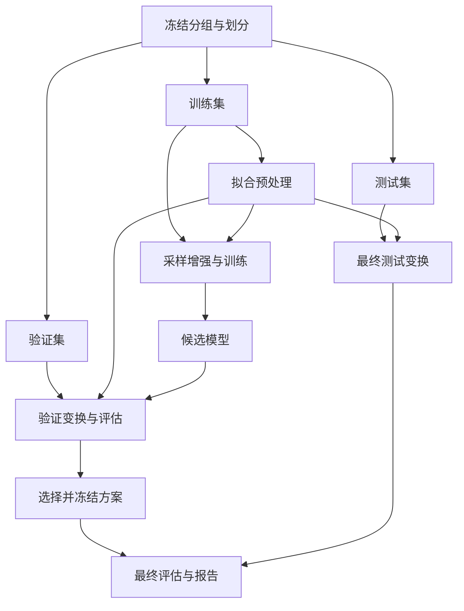

# 第二十二讲：Training Dataset Construction
## 训练数据集构建：控制分布、划分偏差和数据泄漏

第 20 讲解决“哪些数据符合任务要求”，第 21 讲解决“这些数据的版本能否固定和追溯”。这一讲把它们组织成真正用于训练与评测的数据集。

我们要回答的核心问题是：

> **模型的测试成绩，究竟能支持它在什么新数据上有效的结论？**

如果你有 1,000 个原始模型，每个渲染 100 张图，文件数就有 10 万。但把这 10 万张图随机切分，并不一定能评估模型对“没见过的物体”的能力。

这一讲按 **概念 → 原理 → 数据结构 → 算法 → 工程实现 → 评价指标 → 实际案例 → 面试追问 → 小测** 展开。除明确注明的本次合成实验结果，业务案例、比例与阈值均为教学设定。

---

## 一、概念：数据集构建是在设计什么？

### 1.1 它同时是一项训练设计和评估设计

Training Dataset Construction（训练数据集构建）包括：

- 确定任务、输入、输出与目标总体；
- 明确采样单位和数据之间的依赖；
- 选择候选数据、标签和质量规则；
- 划分训练、验证、测试；
- 组织训练采样、预处理与增强；
- 验证划分和分布；
- 冻结可复现的数据发布。

因此，“把文件放进三个文件夹”只是最后的存储形式。

真正需要设计的是：**模型能使用什么信息，评测对哪些对象成立，以及哪些变化必须留给测试。**

### 1.2 先写目标：你希望泛化到哪里？

“泛化 Generalization”不能只写成“模型适应新数据”。必须说明哪些因素是新的。

| 任务中的评估目标 | 典型隔离单位 | 可以支持的结论 |
|---|---|---|
| 新物体分类、部件分割 | 原始物体及其派生家族 | 对未见物体的表现 |
| 新人物绑定、蒙皮或动作预测 | 人物身份，必要时包括动作来源 | 对未见人物的表现 |
| 新建筑或新场景理解 | 建筑、场景、采集区域 | 对未见空间的表现 |
| 新供应商、新设备输入 | 来源域、设备或采集流程 | 对指定新域的表现 |
| 未来生产数据 | 时间及必要的身份关系 | 对较晚时段输入的表现 |
| 已见场景的新视角合成 | 视角及协议规定的观测 | 对该场景未参与拟合视角的表现 |

最后一行尤其重要。

原始 NeRF 的逐场景设置，会用一个场景的部分视图优化该场景表示，再评估其他视图。因此，同一场景出现于训练和测试视图中，并不自动违反这种任务的协议；它不能据此声称对“完全没见过的场景”直接泛化。[R1] genui{"citation":{"ref":"turn916143776view0"}}

**隔离规则必须服务于你要验证的能力。**对新物体任务，换一个相机角度并不能把旧物体变成新物体。

### 1.3 训练、验证、测试分别负责什么？

| 集合 | 主要职责 | 可以影响哪些决策？ |
|---|---|---|
| 训练集 Training Set | 拟合模型及训练相关的预处理状态 | 模型参数、训练统计量 |
| 验证集 Validation Set | 比较候选方案和开发选择 | 超参数、早停、结构、采样与阈值方案 |
| 测试集 Test Set | 在方案冻结后评估预先声明的能力 | 用于报告；不继续反馈到当前方案选择 |
| 校准数据 Calibration Data | 拟合概率映射等后处理 | 校准器及规定的后处理参数 |

验证集也常叫开发集 Dev Set。

校准数据不一定要求第四个永久文件夹。可以在开发数据内部进一步划分，也可以用正确的分组交叉验证或交叉拟合产生未参与基础模型拟合的预测。关键是记录哪些数据参与了什么决策。

scikit-learn 的校准文档强调，拟合校准器时要处理好它与基础模型训练数据的分离。[R2] genui{"citation":{"ref":"turn916143776view1"}}

一个常见误区是：“没有在 test 上反向传播，所以 test 没被使用。”

如果你根据 test 分数选择学习率、提示词、模型版本、筛选阈值或后处理，test 已经参与开发。scikit-learn 的模型选择说明也专门指出这种测试集过拟合风险。[R3] genui{"citation":{"ref":"turn191993739view2"}}

### 1.4 文件、样本和独立单位不是同一件事

以一个椅子为例：

| 层级 | 可能包含什么？ | 是否自动增加独立物体数量？ |
|---|---|---|
| 现实物体/逻辑资产 | 一把具体椅子 | 构成一个身份单位 |
| 几何修订 | 扫描版、修复版、重拓扑版 | 不一定 |
| 表示 | Mesh、点云、SDF、渲染图 | 不一定 |
| 派生记录 | 视角、LOD、旋转、裁剪 | 不一定 |
| 训练样本 | 一条输入—目标配对 | 不一定 |

应区分：

- **Sample**：一次模型输入及其目标；
- **Group**：划分时不能拆开的组；
- **Statistical Unit**：分析泛化和不确定性时使用的独立单位。

它们可以不同。例如一次输入是局部点云，group 是完整原始物体，统计时对每个物体先汇总多个局部预测。

---

## 二、原理：为什么“随机划分”仍可能错？

### 2.1 评测估计的是某个分布下的风险

记 \(x\) 为部署时可以取得的输入，\(y\) 为参考目标，\(f\) 为已经确定的模型，\(\ell\) 为损失函数：

\[
R_P(f)=
\mathbb{E}_{(x,y)\sim P}
[\ell(f(x),y)]
\]

\(P\) 是你关心的目标分布。例如：

> 来自目标供应商、符合接入条件、但身份未在训练中出现过的家具模型。

如果测试数据来自另一分布 \(Q\)，普通测试平均损失通常对应 \(Q\)，不能自动当成 \(P\) 下的结果：

\[
\widehat R_Q(f)=
\frac{1}{n}
\sum_{i=1}^{n}\ell(f(x_i),y_i)
\]

\(n\) 是测试记录数。分类的 0–1 损失没有单位；几何损失则必须说明单位、归一化、对齐与采样协议。

这个表达隐含了评估协议足以支持相应统计解释。测试反馈已经影响模型选择时，即使数据分布相同，也会有额外的选择偏差。

### 2.2 没有泄漏，也可能没有代表性

区分三个概念：

| 问题 | 含义 | 3D 例子 |
|---|---|---|
| 数据泄漏 Data Leakage | 使用了评估协议不允许进入开发或预测的信息 | 训练有原网格，测试有它的简化版 |
| 分布偏移 Distribution Shift | 开发/测试/部署的输入或目标分布不同 | 训练是干净 CAD，部署是有遮挡扫描 |
| 选择偏差 Selection Bias | 采集或筛选让进入数据集的对象偏离目标总体 | 只留下易解析、高质量、常见类别 |

三者可以同时出现，也可以分别出现。

如果产品会收到低质量扫描，而测试集把这些扫描都过滤掉了，测试结果最多描述“通过该筛选条件的扫描”。还应报告拒收比例和完整流程的失败情况。

第 20 讲的质量门禁可以定义准入范围，但**不能用提高质量均分的方式，悄悄改变要评估的使用场景。**

### 2.3 随机的是文件，不代表独立的是物体

假设每个原始物体产生 \(m\) 条记录，每条记录独立地以概率 \(r\) 分到训练集。

给定一条记录已经在测试集，其余 \(m-1\) 条中至少有一条进入训练集的概率为：

\[
P(\text{同源进入训练}\mid\text{该条在测试})
=
1-(1-r)^{m-1}
\]

这是**独立伯努利分配假设下的教学推导**。固定各集合大小的划分不完全服从这个公式，但机制相同。

例如 \(r=0.7,m=6\)：

\[
1-0.3^5=0.99757
\]

即约 **99.757%**。

所以，一个物体只有六个派生记录，按行随机切分就很容易让测试记录与训练记录共享身份。

这里没有证明模型一定记住了物体；它证明的是：这个评估设计几乎没有提供“未见身份”的测试条件。

### 2.4 分组隔离是一个约束

令 \(g(x)\) 表示样本所属的泄漏组，\(G_{\mathrm{tr}},G_{\mathrm{va}},G_{\mathrm{te}}\) 分别是三个集合的组标识集合。

对“未见组”评估，要求：

\[
G_{\mathrm{tr}}\cap G_{\mathrm{va}}
=
G_{\mathrm{tr}}\cap G_{\mathrm{te}}
=
G_{\mathrm{va}}\cap G_{\mathrm{te}}
=
\varnothing
\]

这项检查不同于 sample_id 互不重复。

两个 sample_id 完全不同的记录，仍可能来自同一模型、同一人物或同一次扫描。

scikit-learn 的分组划分正是用于处理这类组内依赖；而 `GroupShuffleSplit` 的比例参数针对**组数**，不是文件行数。[R4] genui{"citation":{"ref":"turn306664198view5"}}

如果一组有 1,000 行，另一组只有 10 行，保留 20% 的组，不意味着恰好保留 20% 的行。

### 2.5 不只是重复文件：七种常见泄漏

| 类型 | 发生方式 | 对应控制 |
|---|---|---|
| 精确重复 | 同一文件以不同路径出现 | 内容摘要核验 |
| 身份/派生泄漏 | 多视图、LOD、修复版跨集合 | 来源、家族和派生关系分组 |
| 预处理泄漏 | 全量数据估计均值、PCA或特征筛选 | 仅训练部分拟合 |
| 目标信息泄漏 | 输入含部署时拿不到的答案线索 | 核对输入可获得性 |
| 时间泄漏 | 用未来信息预测过去 | 时间顺序、信息可用时间及间隔 |
| 选择反馈泄漏 | 根据测试成绩反复调方案 | 开发集与最终测试职责分离 |
| 外部训练重叠 | 基础模型曾使用评测资产 | 记录基础模型与已知重叠，声明未知范围 |

这张表是面向 3D 工作流的教学归纳。有关泄漏的研究也区分了预处理、重复数据、非法特征和评估设计等问题，不能把泄漏简化为“文件是否重名”。[R5] genui{"citation":{"ref":"turn191993739view0"}}

一个 3D 特有例子：

> 点云补全时，输入只有残缺点云，却用完整 Ground Truth 网格的中心和尺度来归一化输入。

如果完整网格在真实预测时不可得，这种处理可能把目标侧信息送给模型。即使它逐样本执行、没有调用 `fit`，也不能因此认为安全。

评测时按协议对输出与 GT 做对齐，是另一个问题；不能把评测对齐悄悄变成模型的输入预处理。

### 2.6 需要学习的预处理状态，只从训练部分取得

以一个标量特征 \(z\) 为例，例如包围盒对角线长度：

\[
\mu_{\mathrm{tr}}
=
\frac{1}{N_{\mathrm{tr}}}
\sum_{i\in D_{\mathrm{tr}}}z_i
\]

\[
\sigma_{\mathrm{tr}}
=
\sqrt{
\frac{1}{N_{\mathrm{tr}}}
\sum_{i\in D_{\mathrm{tr}}}
(z_i-\mu_{\mathrm{tr}})^2
}
\]

之后对所有集合使用同一个变换：

\[
z_i'=
\frac{z_i-\mu_{\mathrm{tr}}}{\sigma_{\mathrm{tr}}}
\]

这里采用总体式方差约定，分母为 \(N_{\mathrm{tr}}\)；标准化后的 \(z_i'\) 无量纲。若标准差为 0，需按预先约定处理，例如保留零特征或使用固定保护规则，不能产生除零。

均值、填补值、PCA、特征选择等都可能携带数据统计信息。scikit-learn 建议在训练集拟合这些变换，再用于其他集合；在交叉验证中应逐折拟合，Pipeline 可以减少误用。[R6] genui{"citation":{"ref":"turn306664198view2"}}

但这不表示所有处理都必须“学习”：

- 固定的厘米转米，是预先确定的单位转换；
- 用当前可见点云计算自身中心，是逐输入处理；
- 用完整目标网格计算残缺输入的中心，则可能使用了不可得的信息。

判断标准是**它读取了什么信息，以及这些信息是否符合任务协议**。

### 2.7 先去重再划分，与先划分再拟合并不矛盾

可以由数据策展者在候选全集上：

- 检查精确重复；
- 确认来源和身份；
- 建立近重复关系；
- 按预先约定的标签进行分层；
- 审核跨集合冲突。

这些活动用于建立数据集边界。

与此同时，进入训练流程的标准化器、特征选择器、表示模型等，不能在通常的归纳学习协议下使用最终测试集拟合。

如果项目采用允许利用未标注测试输入的转导学习或测试时适应，必须把它写成不同的协议，不能与完全隔离的未见数据评估混报。

---

## 三、数据结构：一份可维护的数据集应该有哪些记录？

### 3.1 每条样本至少回答四类问题

1. **身份**：它是谁，来自哪个原始资产？
2. **依赖**：输入、标签、几何修订和本体分别是哪份？
3. **分布属性**：类别、来源、时间、难度和质量如何？
4. **划分依据**：属于哪个泄漏组，为什么进入这个集合？

下面是一个结构示例，摘要为占位符：

```json
{
  "sample_id": "chair-007/view-03/lod-01",
  "asset_id": "chair-007",
  "asset_family_id": "family-007",
  "leakage_group_id": "component-042",
  "parent_sample_ids": [],
  "representation": "rendered_view",
  "geometry_ref": "<mesh digest>",
  "input_ref": "<render digest>",
  "target_ref": "<label digest>",
  "ontology_ref": "<ontology digest>",
  "class_id": "chair",
  "source_domain": "supplier-A",
  "capture_session_id": "capture-018",
  "event_time": "2026-10-01T09:00:00Z",
  "available_at": "2026-10-03T09:00:00Z",
  "quality_policy_ref": "<policy digest>",
  "quality_decision": "accept",
  "split": "train",
  "split_spec_ref": "<split specification digest>"
}
```

这里保留两个时间：

- `event_time`：事件或采集发生时间；
- `available_at`：这条信息实际进入系统、可供使用的时间。

评估未来预测时，只看采集日期而忽略“当时是否已可获得”，仍可能用到未来信息。

`asset_family_id` 和 `leakage_group_id` 也不必相同。后者可能把多个相关家族进一步合并，例如同一人物的不同角色服装版本。

### 3.2 划分规则和划分结果都要保存

| 文件或记录 | 保存什么？ |
|---|---|
| Task Card | 输入、目标、泛化范围、目标总体、允许共享的信息 |
| Candidate Manifest | 候选数据及版本、拒收/隔离状态 |
| Group Registry | 家族关系、近重复关系、最终组及其依据 |
| Split Specification | 硬约束、目标比例、分层字段、算法与随机性 |
| Split Manifest | 实际 sample_id → split 的完整对应 |
| Preprocessing Record | 拟合成员、参数、代码版本、统计量 |
| Sampling/Augmentation Recipe | 训练采样概率、增强参数、父样本关系 |
| Dataset Card / Datasheet | 数据构成、适用范围、限制、维护与变更说明 |

Datasheets for Datasets 明确提出记录采样总体、实例关系、推荐划分及理由等信息。[R7] genui{"citation":{"ref":"turn916143776view3"}}

例如：

```json
{
  "task": "unseen-object-part-segmentation",
  "split_unit": "leakage_group_id",
  "ratios": {"train": 0.7, "validation": 0.15, "test": 0.15},
  "hard_constraints": ["no_group_overlap"],
  "stratify_by": ["class_id"],
  "seed": 22,
  "group_registry_ref": "<group registry digest>",
  "candidate_snapshot_ref": "<candidate digest>",
  "assignment_ref": "<actual member assignment digest>",
  "test_role": "final_evaluation"
}
```

这是设计示例，不代表 70/15/15 是通用最优比例。

第 21 讲已经解释了为什么只记录随机种子不够。这里还要固定候选名单、排序、组关系、算法版本和最终分配。

### 3.3 训练数据加载器要区分输入字段与审计字段

即使清单中有 `class_id`、`quality_decision`、`source_domain`，也不能全部无差别喂给模型。

例如：

- 用类别名称命名的文件路径可能直接暴露答案；
- 某个供应商只提供某一类物体，source_id 可能成为捷径；
- 人工最终审核结果若在预测时不可得，就不能作为预测输入。

推荐明确维护：

```text
model_input_fields
target_fields
audit_only_fields
available_at_inference
```

有些来源信息确实在部署时可用，但是否让模型依赖它，仍要与泛化目标一致，并用来源分层或域外评估检查这种依赖。

---

## 四、算法：怎样构建可信的划分与训练流程？

### 4.1 第一步：定义任务契约

先完成六个句子：

1. 模型输入是……
2. 输出或参考目标是……
3. 实际使用的数据来自……
4. 测试要覆盖的新因素是……
5. 不允许跨集合共享的关系是……
6. 结果按什么单位和权重汇总……

例如：

> 输入一个未见家具资产的局部点云，预测可见点的部件类别；训练与测试隔离原始物体及派生版本；按物体汇总后再按类别报告；部署输入不包含完整目标网格。

这比“做一个高质量 3D 数据集”更能指导后续选择。

### 4.2 第二步：先建立不能拆开的组

当一个任务有多种硬隔离关系时，不能只选一个字段分组。

假设：

- A、B 来自同一原始网格；
- B、C 是确认的近重复；
- 这两种关系都被任务规定为必须同组。

那么 A、B、C 都应进入同一个连通分量。

可以用并查集（Union-Find）实现：

```text
为每条候选记录创建一个集合
对每条已确认的“必须同组”关系：
    合并两个集合
把最终连通分量作为 leakage_group_id
整个分量分配到一个 split
```

若有 \(N\) 个节点、\(E\) 条关系，带路径压缩和按秩合并的并查集总体开销近似线性，通常写为 \(O((N+E)\alpha(N))\)，其中 \(\alpha\) 是增长极慢的反阿克曼函数。

注意：

- “相似”不自动等于必须合并，要先确定关系阈值、证据与任务含义。
- 普通公共纹理、通用背景或基础零件，不一定都属于硬隔离关系。
- 错误关系可能把大量数据连成巨型组；需要审核桥接边。
- 一旦某种关系被确定为硬约束，就不能为了凑比例任意拆开连通分量。

### 4.3 第三步：在整组隔离的前提下考虑分层

Stratification（分层）希望不同集合拥有适当的类别或属性分布。

它与 Grouping（分组）解决不同问题：

- 分组控制依赖关系；
- 分层控制构成比例。

可以把分配视为一个约束优化问题：

\[
\min J=
\lambda_N\sum_s
\left|\frac{N_s}{N}-r_s\right|
+
\lambda_C\sum_s\sum_c
\left|p_s(c)-p_s^*(c)\right|
\]

其中：

- \(s\) 表示 train、validation、test；
- \(N_s/N\) 是记录数比例，\(r_s\) 是其目标值；
- \(p_s(c)\) 是集合 \(s\) 的类别比例；
- \(p_s^*(c)\) 是为该集合规定的目标类别比例；
- \(\lambda_N,\lambda_C\) 是非负权重。

约束是每个组只能进入一个集合。各集合还需满足非空、必要类别支持等要求。

这是教学上的优化表达，不是某个库的原样目标函数。若优化对象是组数，需把 \(N_s/N\) 换成组数比例；多标签属性也不能直接当互斥类别分布处理。

`StratifiedGroupKFold` 会在组不重叠的约束下尽量保持类别比例；官方文档也指出，少量大组可能使分层无法实现。[R8] genui{"citation":{"ref":"turn306664198view4"}}

**身份隔离是硬约束，精确比例通常是软目标。**

如果某类别只有两个独立组，就无法在三个互不重叠的集合里各保留一组。换更多随机种子也不能解决这个数学限制。

可以增加独立数据、调整评估方案或减少折数，并明确该类无法支持哪些结论。复制旧资产或拆开同源视角不构成补充独立数据。

### 4.4 第四步：选择适合任务的划分方式

| 方法 | 适用前提或目的 | 常见错误 |
|---|---|---|
| 随机按行划分 | 行可合理视为独立，且要评估相同总体 | 忽略同源、人物或场景依赖 |
| 分层随机划分 | 希望保留类别构成 | 误以为分层自动防止家族泄漏 |
| 分组划分 | 评估未见组 | 忽略每组大小和类别支持 |
| 分组加分层 | 同时兼顾隔离与构成 | 强行要求所有比例精确一致 |
| 时间划分 | 评估后续时段 | 未来标签/统计量进入过去 |
| 域外划分 Domain Holdout | 评估未见来源或设备 | 把类别变化与来源变化混成一个因素 |

时间划分通常采用较早数据训练、之后验证、更晚测试；重叠窗口、延迟标签和重复身份可能还需要间隔或额外排除规则。

`TimeSeriesSplit` 提供时间顺序划分与 gap 参数，但 gap 的单位是样本数；该工具本身不会替你识别物体家族、业务时间窗口和信息可用时间。[R9] genui{"citation":{"ref":"turn306664198view6"}}

如果“新物体”和“未来数据”都是要求，就要同时满足时间与身份约束。处理跨时间家族的方式应预先定义，不能把未来记录挪到过去训练。

### 4.5 第五步：冻结划分，再拟合、采样和增强

以下流程强调信息的去向：



模型选择可以反复利用验证数据，但每一次交叉验证的预处理拟合都必须限定在相应训练折内。

选择完成后，如果计划把 train 与 validation 合并重训，要提前规定重训方式、训练轮数等。最终校准和后处理仍需适当的数据隔离，最终 test 继续保持独立。

不要在合并重训后，根据 test 分数重新挑训练轮数。

### 4.6 第六步：训练采样不必复制测试分布

训练分布可以为了优化而调整。例如稀有类别在自然数据中太少，可以：

- 重采样；
- 调整损失权重；
- 限制单一资产的视角数；
- 增加独立长尾资产；
- 使用经验证的增强。

但先区分两种随机抽样：

**按行均匀抽样：**拥有更多视角的资产更频繁出现。

**层级采样（Hierarchical Sampling）：**先选类别，再选家族，再选视图。

若类别 \(c\) 被选中的概率为 \(q_c\)，该类有 \(G_c\) 个家族，家族 \(g\) 有 \(n_g\) 条记录，并在后两层均匀抽样，则一条记录的概率为：

\[
P(i)=\frac{q_c}{G_c\,n_g}
\]

这里假设每个家族属于一个类别。多标签或混合类别组需要另行设计。

这种采样可以控制大资产、多视图资产对训练的支配，但它不等于生成了更多独立物体。过采样与类别加权同时使用时，也要检查是否重复放大了某类的训练权重。

测试集则应保持预先设计的分布与权重，不跟着每轮训练采样策略改变。

### 4.7 第七步：增强要继承来源，并正确变换标签

离线增强通常在划分之后，从训练源产生。新样本记录父样本、变换参数和种子，并继承训练归属。

3D 中尤其要注意：

- 旋转点云时同步旋转法线和相关方向量；
- 镜像可能改变左右部件、手性或动作含义；
- 简化、裁剪、重采样可能改变点/面标签对应；
- 强遮挡可能移除目标部件，目标定义需一致；
- 条件图像与目标几何的坐标和相机必须同步。

测试可以按预先冻结的协议包含鲁棒性扰动或测试时增强，但这些测试变体不能倒流到训练，也不能按测试效果反复选择有利的变换。

### 4.8 第八步：比例服从样本支持与评测精度

80/10/10、70/15/15 都只是起点。

应该问：

- 每个关键类别有多少**独立测试组**？
- 重要来源、难度和结构是否有足够支持？
- 训练规模能否支持目标模型？
- 验证集能否稳定比较候选方案？
- 测试估计的不确定性有多大？

对独立、同分布的二分类正确/错误结果，用正态近似规划准确率误差半宽 \(\varepsilon\) 时：

\[
n\approx
\frac{1.96^2 p(1-p)}{\varepsilon^2}
\]

\(p\) 是预估正确率，1.96 对应近似 95% 区间。取最保守的 \(p=0.5\)、\(\varepsilon=0.05\)，约需 385 个独立观察。

这只是样本量规划的近似，不能直接套在成千上万条高度相关视图上，也不是对实际置信区间的替代。类别和域的分层结论还需要各自足够支持。

### 4.9 第九步：发现测试污染后，保存事实并修订评估

如果测试样本被反复用于调整模型：

1. 记录污染方式与受影响实验；
2. 保留原报告和限制说明；
3. 将相关集合视为已参与开发的数据；
4. 在条件允许时建立新的独立测试；
5. 后续结论说明新旧评测协议差异。

不是“改一个 seed”或“重命名 test_v2”就能抹去已经获得的信息。

重复跑一个事先冻结的测试程序，不必然构成泄漏；关键在于结果是否持续反馈到方案选择，以及结论是否考虑了这种适应性使用。


---

## 五、工程实现：一个可以实际运行的构建实验

### 5.1 实验要验证什么？

我们使用 **120 个合成资产家族、720 条元数据记录**：

- chair、lamp、table 三个类别，各 40 个家族；
- 每家族 3 个视角，每视角 2 个 LOD，共 6 条记录；
- 目标是“已知类别中，未见资产家族的分类”；
- 训练、验证、测试目标比例为 70% / 15% / 15%。

本实验没有解析真实 Mesh，也没有训练神经网络。它验证的是**划分与信息使用规则**。

完整代码：[dataset_construction_lab.py](https://github.com/lucinwen/3d/blob/main/examples/lesson22/dataset_construction_lab.py)。

在仓库根目录运行：

```bash
python examples/lesson22/dataset_construction_lab.py --output examples/lesson22/example-report.json
```

只需要 Python 3.10+ 标准库，无需第三方依赖或 GPU。本次实际运行使用 **Python 3.12.14，退出码 0**；保存的完整报告与标准输出逐字相等，独立复跑结果一致。

### 5.2 相同比例，可以得到完全不同的评测协议

第一种方法将所有记录随机打乱，再按行切分。

第二种方法先按家族聚合，在每个类别内分配完整家族。

本次实际结果：

| 检查项 | 按行随机划分 | 按家族分组并类别分层 |
|---|---:|---:|
| train / validation / test 记录数 | 504 / 108 / 108 | 504 / 108 / 108 |
| train / validation / test 家族数 | 120 / 69 / 78 | 84 / 18 / 18 |
| 出现在多个集合的家族数 | 104 | 0 |
| train 与 test 共享家族数 | 78 | 0 |
| 测试记录中，家族已在 train 出现 | 108 / 108 | 0 / 108 |
| 测试记录家族暴露率 | 100% | 0% |

两者的记录数比例一模一样，但第一种方法没有保留任何完全未见过的测试家族。

注意，第一列的家族数不能相加后当作总家族数：同一家族会被重复计入多个集合。

正确方案中，每个类别都是：

- train：28 个家族、168 条记录；
- validation：6 个家族、36 条记录；
- test：6 个家族、36 条记录。

这里各家族大小相同，所以家族数比例与记录数比例恰好相同。一般数据并不保证如此。

### 5.3 预处理要检查实际成员，不能只信一个声明

下面是完整脚本中的核心函数。它依赖同文件的校验器、摘要函数和导入，不是独立可运行程序：

```python
def fit_preprocessor(rows, assignment, fit_ids):
    """Permit exactly the frozen training members, never validation/test rows."""
    validate_assignment(rows, assignment)
    if len(fit_ids) != len(set(fit_ids)) or set(fit_ids) != set(assignment["train"]):
        raise ValueError("preprocessor_fit_scope_must_equal_train")
    row_map = {row["sample_id"]: row for row in rows}
    values = [row_map[i]["bbox_diagonal_mm"] for i in sorted(fit_ids)]
    std = statistics.pstdev(values)
    if std == 0:
        raise ValueError("zero_variance_feature")
    return {"feature": "bbox_diagonal_mm", "input_unit": "mm",
            "fit_split": "train", "fit_count": len(fit_ids),
            "fit_member_ids_sha256": digest(sorted(fit_ids)),
            "mean": statistics.fmean(values), "population_std": std,
            "output_unit": "dimensionless"}
```

本实验输入是一个合成标量特征 `bbox_diagonal_mm`，整体形状为 `(720, 1)`，单位毫米。它不是从真实网格测量的结果。

训练集 504 条记录拟合得到：

\[
\mu_{\mathrm{train}}=1160.857142857143\ \mathrm{mm}
\]

\[
\sigma_{\mathrm{train}}=295.12685500343355\ \mathrm{mm}
\]

随后，把所有验证和测试特征都增加 10,000 mm，再使用原训练成员重新拟合。

这个扰动发生在临时副本中，不修改冻结的原始数据版本。

**训练均值与标准差完全不变。**

代码中，均值与标准差仅由冻结训练成员的特征计算；这次扰动检查确认，本例留出特征的变化没有改变这两个统计量。如果错误地改用全部数据计算均值，则会得到 4158.5 mm；这个反事实结果只用来展示污染，没有用于正式变换。

这个函数要求“拟合成员恰好等于全部基础训练成员”，是本实验的约定。生产系统也可以使用预先声明的训练子集或加权统计，但必须记录真实成员和权重，且不能混入禁止使用的数据。

### 5.4 八种故障，必须明确失败

| 注入的错误 | 实际拦截原因 |
|---|---|
| 缺少家族 ID | `missing_row_fields` |
| 样本 ID 重复 | `duplicate_sample_id` |
| 有记录未分配到任何集合 | `unassigned_sample` |
| 同一记录跨集合分配 | `duplicate_or_cross_assigned_sample` |
| 同一家族跨集合 | `family_split_leakage` |
| 用全部数据拟合预处理 | `preprocessor_fit_scope_must_equal_train` |
| 从 test 父样本生成训练增强 | `augmentation_parent_not_train` |
| 某类只有两个家族，却要求覆盖三个集合 | `infeasible_class_group_support:rare` |

八项在本次运行中全部按预期被拦截，正确 manifest 的摘要保持不变。将输入行顺序整体反转后，分组方案也得到相同的成员清单。

报告还保留了三个训练增强元数据示例。它们仅将合成特征乘以 1.01，位于冻结的 720 条基础记录之外，没有参与上述均值、方差拟合。

### 5.5 为什么代码里还放了一个“身份查表”基线？

这个玩具基线只记住：

> family_id → 类别；遇到未知家族，就猜训练多数类。

实际结果：

- 按行划分：108 / 108 = 100%；
- 按家族划分：36 / 108 = 1/3。

它直接使用家族身份，因此只是用来演示捷径机制。**它没有学习几何，不是 3D 模型成绩，也不意味着真实模型在分组测试上只能得到 1/3。**

真正的价值是：一个完全不会理解形状的查表程序，也可以在错误协议下获得满分。

### 5.6 这个实验的证据边界

它证明了代码对**已知家族关系与规定的信息流**实施了这些检查。

它没有完成：

- 真实近重复发现或多关系连通分量构建；
- 组内多类别、组大小悬殊情况下的通用优化；
- 时间外、来源外或类别外泛化评估；
- 真实三维增强、模型训练和置信区间估计。

“已知家族重叠为 0”不等于“所有潜在泄漏都为 0”。

---

## 六、评价指标：如何验收一个构建好的数据集？

数据集验收至少要回答：**有没有违规共享、有没有足够支持、代表什么分布、能否支持目标结论。**

### 6.1 支持数：同时数记录、资产和组

每份集合至少报告：

| 统计项 | 作用 |
|---|---|
| 记录数 | 估计读取、训练和存储规模 |
| 原始资产数 | 判断真正覆盖了多少对象 |
| 最终隔离组数 | 判断泛化测试有多少组级支持 |
| 每类、每来源的组数 | 发现长尾和来源覆盖缺口 |
| 每组记录数分布 | 发现少数资产产生大量视图的问题 |
| 类别 × 来源 × 难度的交叉支持 | 发现单看各维统计无法看到的混杂 |

例如“椅子 10 万条记录”可能来自 20 把椅子；“来源 A、B 都有数据”可能实际上是 A 只有椅子，B 只有桌子。

这里的组数仍以分组规则正确为前提。如果家族登记遗漏了同源关系，统计表会高估独立支持。

### 6.2 已知关系暴露率：写清分母

定义测试记录家族暴露率：

\[
E_{\mathrm{test}\leftarrow\mathrm{train}}
=
\frac{
\sum_{i\in D_{\mathrm{test}}}
\mathbf{1}\!\left[g(i)\in G_{\mathrm{train}}\right]
}{
|D_{\mathrm{test}}|
}
\]

其中：

- `g(i)`：测试记录所属的隔离组；
- `G_train`：训练组集合；
- 分母是测试记录数；
- 指标无单位，取值 0～1；
- 测试集为空时应报告无定义并拒绝验收，不能填成 0。

同时报告组交集数量：

\[
|G_{\mathrm{train}}\cap G_{\mathrm{test}}|
\]

这是“共享组有多少”，与上面的“多少测试记录暴露于已见组”是不同统计。

对本讲的新家族任务，两项都应为 0；但还要单独审计验证集、增强谱系、目标信息和人工反馈。

### 6.3 分布差异：先选参照，再计算差距

对于互斥且穷尽的类别，可以用总变差距离 Total Variation：

\[
\mathrm{TV}(p,q)
=
\frac{1}{2}\sum_{c=1}^{C}|p_c-q_c|
\]

`p`、`q` 是在同一类别定义、同一计数单位下的概率分布，取值范围为 0～1。

如果一个分布按“记录数”算，另一个按“资产数”算，直接比较会混入权重差异。

更关键的是参照对象：

- 代表生产输入的测试集，应与目标生产总体比较；
- 类别均衡测试集，应与声明的均衡目标比较；
- 域外挑战集，本来就可能刻意偏离训练分布。

因此，“train 与 test 分布越接近越好”不是通用验收标准。域外评估需要的是清楚、可复现的偏移定义。

TV 也只能检查选定分类维度，无法证明几何、纹理、采集条件等完整联合分布一致。

### 6.4 逐记录平均与逐资产平均回答不同问题

设测试集有 `G` 个资产，第 `g` 个资产有 `n_g` 条记录，损失为 \(\ell_{gj}\)，总记录数 \(N=\sum_g n_g\)。

逐记录平均：

\[
R_{\mathrm{record}}
=
\frac{1}{N}
\sum_{g=1}^{G}\sum_{j=1}^{n_g}\ell_{gj}
\]

逐资产等权平均：

\[
R_{\mathrm{asset}}
=
\frac{1}{G}
\sum_{g=1}^{G}
\left(
\frac{1}{n_g}\sum_{j=1}^{n_g}\ell_{gj}
\right)
\]

前者让视图更多的资产权重更高；后者先计算资产内部平均，再让每个资产等权。

如果每个资产记录数相同，两者一致；不同时，可能明显不同。

对点级分割还有类似问题：

- 把所有点混在一起统计，会让大点云权重更高；
- 先逐物体计算，再做物体平均，回答的是另一种问题；
- 类别、部件缺失和 IoU 分母为零时怎样处理，也必须提前规定。

一张分数表应写出**单位、聚合顺序和权重**，而不只写一个“mIoU”。

### 6.5 平衡测试成绩，不能自动当作生产成绩

假设一个分类器在两类中的准确率分别为：

| 类别 | 类内准确率 |
|---|---:|
| A | 90% |
| B | 60% |

在两类等权的测试协议下：

\[
0.5\times 0.90+0.5\times 0.60=0.75
\]

若目标生产总体中 A 占 90%、B 占 10%，且两类内部的准确率仍适用：

\[
0.9\times 0.90+0.1\times 0.60=0.87
\]

75% 与 87% 可以同时正确，它们对应不同权重。

但是，这里明确假设：目标总体的**类内条件与表现没有额外改变**。如果生产中的 B 更模糊、更残缺，仅改类别权重不能修复偏差。

这种线性计算适用于准确率或可逐样本平均的损失，不能直接照搬为 F1 等非线性指标的总体计算。

### 6.6 不确定性要按依赖关系计算

如果一个物体有 100 张高度相关的视图，把这 100 张图当成 100 个独立物体，会夸大证据量。

对以新资产为目标的评测，一种工程方案是：

1. 先冻结逐记录、逐资产等权或其他聚合方式；
2. 从测试资产组中有放回抽样；
3. 每次抽中某组时，携带它的全部相关记录；
4. 重算同一指标，形成重采样分布。

这称为组级/簇级 Bootstrap。它仍依赖组间可合理视作独立、组数足够、采样协议与目标总体相符等条件。

如果真正的依赖单位是建筑，就不能只按建筑中的单个房间重采样；如果目标是未见来源，来源只有两个，不能靠给每个来源增加几千张图获得充分的来源级证据。

交叉验证各折的分数标准差也不自动等于正式的置信区间。

本讲代码没有计算这些区间。它们属于真实模型实验阶段需要另行实现和解释的内容。

### 6.7 一个可以采用的发布验收表

以下为工程建议，不是行业统一阈值：

| 项目 | 验收要求 |
|---|---|
| 成员完整性 | 每条候选记录有明确去向；排除记录保留理由 |
| 行级互斥 | 同一记录不跨集合 |
| 任务规定的组级互斥 | 禁止共享的组交集为 0 |
| 预处理与增强 | 拟合成员、父样本和信息来源可核验 |
| 类别与域支持 | 达到预先声明的最低独立组支持；不足项明确失败或限定结论 |
| 分布说明 | 目标分布、实际分布、权重与偏差可解释 |
| 发布复现 | 实际成员、候选版本、代码、配置及标签版本冻结 |
| 测试使用记录 | 能说明测试是否参与过开发决策 |

---

## 七、实际案例：构建“未见物体的部件分割”数据集

这是一个**教学设计案例**，不冒充已经完成的真实业务实验。

### 7.1 先写任务卡

假设产品接收用户上传的局部点云，输出每个输入点的部件类别。

任务约定：

- 输入：上传时实际可见的点、颜色及允许使用的传感信息；
- 输出：这些可见点的部件标签；
- 目标：已知物体类别中的新物体；
- 隔离：同一原始资产、重拓扑版、LOD、扫描修复版及确认的近重复属于同一隔离组；
- 指标：按协议定义的逐物体分割指标，并报告每类、每来源和困难子群；
- 输入归一化：只使用部署时可得的信息，不能使用隐藏完整 GT 的中心与尺度。

最后一条很容易被忽略：即使完整网格只用于“帮忙归一化”，它仍可能告诉模型本来需要预测的几何范围。

### 7.2 先处理版本，再建立分组

从前两讲承接：

1. 固定几何、标签本体和质量策略版本；
2. 保存被筛掉的记录及原因；
3. 建立来源、派生、修复和近重复关系；
4. 根据本任务的硬隔离关系生成最终组；
5. 检查类别与来源的交叉覆盖，再分配集合。

如果“椅子全部来自来源 A，桌子全部来自来源 B”，模型可能把来源特征当成类别线索。

这时，单纯做类别分层不会解决问题；直接留出来源 B 又会同时留出全部桌子，难以区分“新来源”与“新类别”的影响。

应优先补充交叉覆盖，例如两个来源都具有椅子与桌子；暂时补不到，就明确承认现有数据不能单独验证来源泛化。

### 7.3 分开保留三种评测用途

| 评测轨道 | 构造方式 | 支持的结论 |
|---|---|---|
| 代表性测试 | 从目标总体采样，隔离未见资产 | 对所声明生产总体的表现 |
| 困难挑战集 | 预先定义遮挡、薄结构、细小部件等条件 | 对指定困难条件的表现 |
| 来源外测试 | 留出指定来源，并处理相关身份关系 | 对该来源变化的表现 |

三者可以互补，但不要随意混成一个总分，再称为“总体生产效果”。

如果产品明确会拒绝某些输入，应同时报告拒绝率、接收覆盖率和已接收输入上的性能。只报告通过筛选后的高分，会隐藏实际服务覆盖范围。

### 7.4 发布包至少包含什么？

一个可维护的版本，应能回答：

- 哪批候选资产与标签进入了构建；
- 哪些数据因何被排除；
- 最终分组由什么关系和版本得到；
- 每个 sample_id 实际属于哪个集合；
- 预处理在哪些训练成员上拟合；
- 增强从哪些父样本产生；
- 模型选择用了哪些开发数据；
- 测试的采样协议、聚合方法与使用记录是什么。

下一讲做困难样本挖掘时，优先从训练和开发失败池中选样。

如果把密封测试集的失败样本加入训练，那么它已参与下一轮开发；后续需要相应调整评估数据和结论，不能继续把原测试分数当作未受反馈影响的证据。

---

## 八、面试追问：从“会切数据”到“会解释证据”

### 8.1 问：按 8:1:1 切分为什么还可能不可信？

**答：**比例只描述数量，没说明目标总体、独立单位和信息使用方式。同源资产、多视角、LOD 或未来信息跨集合，都会让成绩偏离宣称的泛化任务。先定义新对象、新来源还是未来数据，再决定分组、时间或域外协议。

**追问：文件 SHA-256 都不同，能证明没有泄漏吗？**

不能。不同序列化、重拓扑、渲染或轻微变形可产生不同字节，却仍来自同一物体。文件去重只能检查其中一层关系。

### 8.2 问：Stratification 和 Grouping 谁优先？

**答：**任务禁止共享的关系是硬约束；类别比例通常是优化目标。应在不拆组的前提下尽量匹配分布，再报告实际偏差。

**追问：拆开一个大组就能达到完美比例，为什么不拆？**

因为你会改变被验证的泛化问题。若约束不可行，应补数据、调整比例或公开修改协议，不能静默破坏隔离。

### 8.3 问：已有 asset_id，为什么还要 family_id 或 leakage_group_id？

**答：**asset_id 可能只标识某次上传或某个文件。多个 asset_id 可能对应同一源资产的不同版本，也可能受其他必须隔离的身份关系连接。最终 group 应覆盖本任务全部禁止共享的关系。

**追问：共享同一套通用材质，就必须并组吗？**

不一定。先判断材质共享是否违反目标能力的隔离要求。把所有通用资源都当硬关系，可能导致没有意义的巨型组。

### 8.4 问：预处理必须全部在切分后进行吗？

**答：**需要区分操作。全局去重、关系登记和按已定规则分层属于数据策展；会进入模型的数据估计状态，应在允许的训练数据内拟合。确定性操作也要检查是否偷偷读取了部署时不可得的目标信息。

**追问：仅把完整 GT 的包围盒用于输入归一化，可以吗？**

若部署时拿不到完整 GT，这可能泄漏。应使用实际输入可得的尺度信息，或明确把额外尺度信息定义为任务输入。

### 8.5 问：长尾类别太少，应把测试集也过采样吗？

**答：**先明确测试目的。需要类别均衡诊断时，可以设计均衡测试和宏平均；需要生产总体估计时，应保持对应的采样与权重。复制同一测试资产不会增加独立支持。

**追问：训练过采样是否增加有效物体多样性？**

它改变训练频率，不会把一个物体变成多个独立物体。增加独立长尾资产与重复看旧资产，解决的是不同问题。

### 8.6 问：某类别只有两个独立组，能保证 train、val、test 都有它吗？

**答：**在三份集合互斥且都要求该类非空时，不能。可增加独立数据、改用可行的分组评估、减少集合或折数，或限定该类别的结论。

**追问：把其中一个组增强成一千份呢？**

仍然只有两个独立组。增强不能突破这个可行性限制。

### 8.7 问：测试集一定只能运行一次吗？

**答：**应防止测试结果进入自适应开发决策。重复执行冻结程序做复现，与根据分数反复换模型，是不同情形。实践中限制访问有助于执行，但“次数”本身不是完整定义。

**追问：已经根据测试失败修改了模型，怎么办？**

记录事实，将受影响的数据视为参与过开发，建立适当的新测试或在报告中明确限制。改名和换 seed 不能删除开发者已经知道的信息。

### 8.8 问：家族零重叠、测试高分，上线却很差，先查什么？

**答：**按证据链检查：目标总体是否一致，来源与类别是否混杂，输入可用性是否一致，质量筛选是否遗漏真实困难输入，标签定义是否一致，训练和部署预处理是否一致，以及是否有未登记的同源或预训练重叠。

**追问：能马上断定是过拟合吗？**

不能。也可能是分布偏移、覆盖不足、标签口径变化或部署工程错误。先定位差异，再决定补数据、改采样、修实现还是改模型。

---

## 九、小测：检验你是否能设计一份可信划分

建议先作答，再看答案。以下是教学自测，尚未记录你的个人完成或掌握状态。

### 9.1 十道客观题

每题 4 分，共 40 分。

1. 为评估新物体能力，把同一物体的不同渲染视角随机分到 train 与 test，是否满足资产隔离？
2. `GroupShuffleSplit(test_size=0.2)` 是否保证测试记录恰好占总记录数的 20%？
3. 在切分前，用全部候选数据拟合 PCA，再只在 train 上训练分类器，是否满足通常的归纳评估协议？
4. 策展者在划分前用全局文件摘要去重，是否必然构成模型信息泄漏？
5. 某类别只有两个独立家族，要求三个互斥集合都出现该类别，是否可行？
6. 在原始 NeRF 的逐场景新视角协议中，同一场景的训练和测试视图，是否必然构成违规共享？
7. 测试有 100 条记录，其中 30 条属于训练中出现过的组；本讲定义的测试记录家族暴露率是多少？
8. 如果部署输入只有局部点云，使用完整 GT 的包围盒归一化输入，是否可能泄漏？
9. 已知 group 交集为 0，是否证明未知近重复和预训练数据重叠也为 0？
10. 类别 A、B 的类内准确率为 90%、60%，两类等权平均是多少？

**答案与解释：**

| 题号 | 答案 | 解释 |
|---|---|---|
| 1 | 不满足 | 不同视角仍对应同一目标物体，不能支持未见物体结论。 |
| 2 | 不保证 | 参数针对组；组大小不同，记录数比例可不同。[R4] |
| 3 | 不满足 | PCA 的拟合状态已经使用了留出数据的信息。 |
| 4 | 不必然 | 全局去重是建立候选集与划分关系的策展步骤；还需检查其用途和信息流。 |
| 5 | 不可行 | 两个组无法在保持互斥时覆盖三个非空集合。 |
| 6 | 不必然 | 该协议评估已见场景的新视角；不能由此声称未见场景泛化。 |
| 7 | 30% | 分母是 100 条测试记录，分子为 30。 |
| 8 | 可能 | 完整目标几何包含部署时不可得的信息。 |
| 9 | 不能 | 检查只覆盖已知、已登记的关系。 |
| 10 | 75% | `(0.90 + 0.60) / 2 = 0.75`。 |

### 9.2 三道分析题

每题 20 分，共 60 分。

**题一：1,000 个原始资产，每个有 12 个视图。目标是评估新资产，按 70% / 15% / 15% 分组划分。应该得到多少资产和记录？若其中一个类别只有两个家族，如何处理？**

参考答案：

- 总计 12,000 条记录；
- train：700 个资产、8,400 条记录；
- validation：150 个资产、1,800 条记录；
- test：150 个资产、1,800 条记录；
- 上述精确数量假设每个资产是独立组、没有跨资产合并关系、每组恰好 12 条记录，且未施加其他导致比例不可行的约束；
- 只有两个家族的类别，无法同时覆盖三份互斥集合。应补充独立家族，或调整并公开评测协议，不能拆组或复制视图凑数。

评分：数量计算 8 分；假设与隔离单位 6 分；稀有类别处置 6 分。

**题二：等类权测试准确率为 75%，有人说“线上 A 占 90%，所以线上准确率必然是 87%”。这句话有什么问题？**

参考答案：

若 A、B 的类内准确率分别为 90%、60%，且这些类内表现适用于目标生产总体，则加权值为：

\[
0.9\times 0.9+0.1\times 0.6=0.87
\]

但仅知道总体 75%，不足以唯一推导两类准确率；还必须知道类别条件表现。

即使已知两类准确率，生产中的来源、难度、输入处理或标签定义发生变化，也会使条件不成立。因此 87% 是带假设的计算结果，不能替代实际部署代表性评估。

评分：正确计算 6 分；指出必须知道类内表现 6 分；指出条件变化与外推限制 8 分。

**题三：来源 A 只有椅子，来源 B 只有桌子。项目想报告“对新来源的泛化”。你会怎样设计数据和验收？**

参考答案：

1. 先指出来源与类别完全混杂，现有数据不能单独区分两者影响。
2. 优先补充交叉覆盖，让不同来源具有可比较的类别与难度；仍不足时限定结论。
3. 按任务建立资产家族与必要的跨来源关系，保证需要隔离的身份不跨集合。
4. 设计代表性测试与明确的来源外测试，并分别报告。
5. 预处理仅在允许的训练成员内拟合，训练增强继承训练父样本。
6. 冻结实际成员和分布统计，报告每类、每来源的独立组支持，避免只给一个总体分数。

评分：识别混杂 6 分；采集与划分方案 6 分；信息流控制 4 分；指标与结论边界 4 分。

### 9.3 动手作业

运行本讲脚本后，完成四件事：

1. 找到报告中的 78 个 train/test 共享家族计数与 108 条暴露记录计数，解释为什么它们不同。
2. 修改合成器，让不同家族有不同数量的视图，观察“组数比例正确”时记录数比例是否仍正确。
3. 解释为什么给验证、测试特征加上 10,000 mm，训练拟合统计应该不变。
4. 写一页任务卡，选择“新物体”“新来源”或“未来数据”中的一个目标，说明分组规则、测试分布、最低支持与不可行时的处理。

这项作业的验收重点，是你能否解释**每一个成绩允许支持的结论**，而不仅是脚本是否运行结束。

---

## 本讲参考资料

以下为核对概念与工具行为的一手资料。本文中的 3D 数据结构、验收表和教学实验属于本课程的工程设计。

- [R1：NeRF 原论文](https://arxiv.org/html/2003.08934v2)：逐场景训练及新视角评估。
- [R2：scikit-learn — Probability calibration](https://scikit-learn.org/stable/modules/calibration.html)：基础模型与校准拟合的关系。
- [R3：scikit-learn — Cross-validation](https://scikit-learn.org/stable/modules/cross_validation.html)：验证、测试、分组和模型选择。
- [R4：scikit-learn — GroupShuffleSplit](https://scikit-learn.org/stable/modules/generated/sklearn.model_selection.GroupShuffleSplit.html)：组比例参数及划分行为。
- [R5：Leakage and the Reproducibility Crisis in ML-based Science](https://arxiv.org/html/2207.07048v1)：泄漏类型与研究有效性。
- [R6：scikit-learn — Common pitfalls](https://scikit-learn.org/stable/common_pitfalls.html)：预处理拟合、Pipeline 与信息泄漏。
- [R7：Datasheets for Datasets](https://arxiv.org/html/1803.09010v8)：数据来源、代表性、关系和划分说明。
- [R8：scikit-learn — StratifiedGroupKFold](https://scikit-learn.org/stable/modules/generated/sklearn.model_selection.StratifiedGroupKFold.html)：分组前提下尽量保持类别比例及其限制。
- [R9：scikit-learn — TimeSeriesSplit](https://scikit-learn.org/stable/modules/generated/sklearn.model_selection.TimeSeriesSplit.html)：时间顺序划分与 gap 的语义。

## 课程资料与维护记录

本讲全文、公式、流程图源码、面试问答、小测答案、可运行代码及实际执行结果，已同步到课程仓库并完成远程内容回读核对：

- [第 22 讲完整正文](https://github.com/lucinwen/3d/blob/main/lessons/lesson-22-training-dataset-construction.md)
- [实验说明、代码与完整报告](https://github.com/lucinwen/3d/tree/main/examples/lesson22)
- [本次回复源稿与资料归档](https://github.com/lucinwen/3d/tree/main/archive/lessons/22)
- [发布与回读核验记录](https://github.com/lucinwen/3d/blob/main/archive/lessons/22/delivery-verification.json)

归档保留本次回复的完整撰写源稿；这与从聊天界面独立导出的历史记录是不同的证据。课程进度和 AI 接续说明也已更新，学习状态记录为“已授课、未个人验收”。

下一讲：**第 23 讲，Hard Sample Mining——困难样本挖掘：怎样从开发失败中找到值得补充的数据，同时避免反复适应测试集。**

