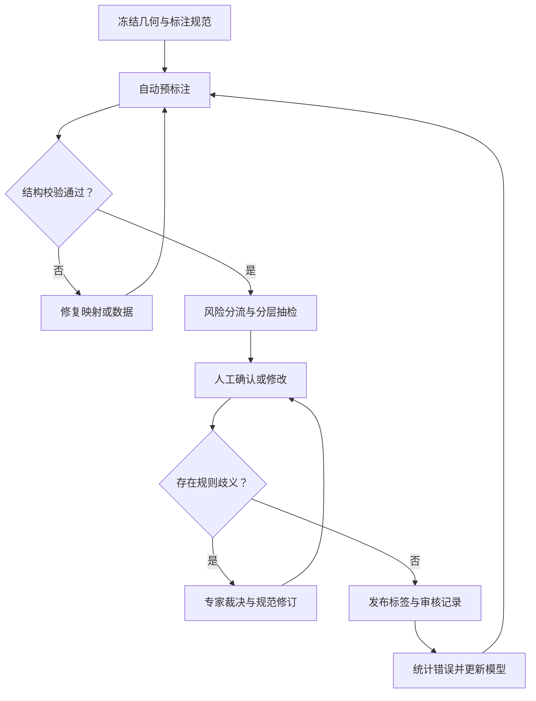

# 第十九讲：Semantic Annotation & Part Labeling

## 语义标注、实例分割、部件标注、点级／面级标签与人机协同审核

**本讲的核心：把“物体是什么、每一件是谁、每个部件在哪里”，变成绑定具体几何版本、能够用于训练和评测的标签。**

第十七讲建立数据来源与样本，第十八讲处理清洗和重复关系；第十九讲开始给数据建立明确的语义。我们贯穿使用一个教学案例：为一批椅子资产，以及包含多把椅子的场景，制作可靠的标注。

学完后，你应当能独立设计标注规范、解释模型输出、实现标签转移、审核自动结果，并发现“指标很好但数据其实错了”的情况。以下类别编号、流程配置和业务案例均是教学设计；公开方法另附一手来源，代码实验的实际运行结果单独说明。

---

## 一、概念：先分清标注到底回答什么问题

### 1.1 五种任务，不能混为一个“分割”

| 任务 | 回答的问题 | 两把椅子的例子 | 典型输出 |
|---|---|---|---|
| 对象分类 Classification | 整个对象是什么？ | 这个资产是椅子 | 一个类别 |
| 语义分割 Semantic Segmentation | 每个位置属于哪类？ | 两把椅子的表面都标为 chair | 每点／每面类别 |
| 实例分割 Instance Segmentation | 同类中，分别是哪一件？ | 椅子 A 与椅子 B 分开 | 实例掩码及类别 |
| 部件分割 Part Segmentation | 对象内部是什么部件？ | seat、back、leg、armrest | 每点／每面部件类别 |
| 部件实例分割 Part Instance Segmentation | 同一种部件分别是哪一个？ | 四根椅腿分别编号 | 部件类别及部件实例 |

**部件分割是对象内部的语义分割；需要区分重复部件时，再加入部件实例。** PartNet 将细粒度部件语义、层次语义和部件实例分别设为研究任务，正是因为它们需要不同的监督信息。[R1]

还有一个相关概念：**全景分割 Panoptic Segmentation**，联合描述语义与实例。对于椅子等可数对象，要区分实例；对于地面等连续区域，则按任务规定处理。部件层次可以额外建立，但并不是只输出全景标签就自然获得。[R2]

### 1.2 用一张表拆开四种身份

以下编号仅作示例，`part_instance_id` 在每个对象内部编号：

| 几何区域 | object_semantic | object_instance_id | part_semantic | part_instance_id |
|---|---|---:|---|---:|
| 椅子 A 的一根腿 | chair | 7 | leg | 1 |
| 椅子 A 的另一根腿 | chair | 7 | leg | 2 |
| 椅子 B 的一根腿 | chair | 12 | leg | 1 |
| 椅子 A 的座面 | chair | 7 | seat | 5 |

第三行的部件 `1` 与第一行的部件 `1` 不是同一个实体。它们的身份分别是 `(12, 1)` 和 `(7, 1)`；跨场景时，还要加入 `scene_id`。

实例 ID 本身不含几何意义：`7` 并不比 `12` 更靠左、更大或者更重要。预测实例编号与真值编号不同，也不代表预测错误；评测要按区域重叠匹配。

### 1.3 “语义层级”与“标签放在哪里”是两条轴

语义、实例、部件决定标签的**含义**；点级、顶点级、面级、体素级决定标签的**承载元素**。

同一把椅子可以同时有：

- 面级 `part_semantic_id`，用于网格编辑。
- 从表面采样得到的点级 `part_semantic_id`，用于训练点云模型。
- 面级 `object_instance_id`，用于场景实例分割。
- 对象级 `material=wood`、`style=modern` 等属性。

材质、风格、功能与部件类别通常应分字段存储。否则一个“木质椅腿”被写成不可拆分的新类别，另一种金属椅腿又成一个类别，类别表会迅速膨胀。

### 1.4 为什么连通块、材质槽、OBJ 文件都不能直接当部件？

一体成型的椅子可能只有一个连通块，却有座面、靠背和支撑；一根椅腿也可能由多个网格片段构成。相同木材可以覆盖所有部件，一个部件也可以包含不同材质。

PartNet 官方格式明确提示：单个 OBJ 片段未必有独立部件语义，多个 OBJ 可能共同组成一个部件，必须结合层次标注文件解析。[R3]

因此，连通块、曲率和材质边界可以帮助提出候选区域，最终的部件含义仍由任务规范决定。

### 1.5 四种容易混淆的“没有标签”

| 情况 | 含义 | 建议处理 |
|---|---|---|
| 未标注 Unlabeled | 还没有完成工作 | 保留待办状态，不当作负样本 |
| 未知／有歧义 Unknown / Ambiguous | 已观察，但无法确定 | 保存原因与候选类别，交复核 |
| 本体外 Out of Ontology | 看得清，但现有类别表没有它 | 记录映射缺口，评估扩充类别表 |
| 背景 Background | 规范定义的有效背景类别 | 可以是正常训练类别 |

`ignore` 则表示**某个训练或评测协议是否使用这个元素**，它不是上述语义状态的同义词。

还有一种对象级状态：这把椅子本来没有扶手。它与“扶手被遮住、无法观察”不同。前者是部件缺省事实，后者是观测不完整。不能因为没有看见，就直接写成“不存在”。

---

## 二、原理：标签为什么必须建立在统一规范和几何对应上？

### 2.1 先定义本体，再开始标注

**本体 Ontology** 是一套明确的类别、层次、关系及使用规则。例如本讲可以定义：

| 路径 | 定义 | 容易混淆的对象 |
|---|---|---|
| chair / seat | 主要承载坐姿人体的座面结构 | 独立软垫是否另分？ |
| chair / back | 为背部提供支撑的结构 | 与扶手连续融合的区域 |
| chair / support / leg | 约定类型的独立腿式支撑 | 支撑横杆、中心立柱 |
| chair / support / stretcher | 连接支撑构件的横杆 | 不能只因细长就叫 leg |
| chair / armrest | 支撑手臂的结构 | 与靠背一体化的边界 |

这只是示例本体，不是所有椅子数据集的标准答案。转椅可能有中心立柱和轮子，悬臂椅可能没有四根独立椅腿；本体必须覆盖目标数据的真实结构。

一个可执行的标注规范至少需要说明：**类别定义、包含与排除例子、边界规则、层级、重复部件编号规则、不可判断时的处理方式。**

比如座面和靠背是一整块连续曲面：如果没有规定功能转折区如何分界，标注员各自画出的边界可能都合理。此时应先解决规范歧义，再讨论谁“标错了”。

### 2.2 层次标签有约束，但不能过度强加

如果本体规定一个父区域由完整、互斥的子区域构成，那么：

$$
\Omega_{\mathrm{parent}}=\bigcup_j\Omega_{\mathrm{child},j},
\qquad
\Omega_{\mathrm{child},i}\cap\Omega_{\mathrm{child},j}=\varnothing\quad(i\ne j).
$$

这里 $\Omega$ 是点、面或表面区域的集合。直观上，所有子部件合起来应覆盖父部件，同一层不能重复占用同一元素。

但如果子部件尚未标全，父区域里可以有“尚未细分”的部分。如果标的是功能区域，例如可抓取区域与支撑区域，允许重叠时应使用多标签或关系结构，而不是强行套用互斥树。

层次还有一个实用作用：只确定某区域属于 `support`、无法确定是 `leg` 还是 `pedestal` 时，可以保存粗粒度确认结果，细粒度保持未知。**粗标签不能伪装成已经确认的细标签。**

### 2.3 语义分割的数学形式

设点云为：

$$
X=\{x_i\}_{i=1}^{N},\qquad x_i\in\mathbb R^d.
$$

$N$ 为点数；每个 $x_i$ 可以包含坐标、颜色、法线等特征。坐标有长度单位，颜色和单位法线通常无量纲，不能混用预处理规则。

有 $C$ 个目标类别时，模型输出每点各类别的概率：

$$
p_i(c)=P(y_i=c\mid X),\qquad
\hat y_i=\arg\max_c p_i(c).
$$

使用已确认标签训练时，一个带类别权重的交叉熵可写为：

$$
\mathcal L_{\mathrm{sem}}=
-\frac{\sum_i m_i w_{y_i}\log p_i(y_i)}{\sum_i m_i w_{y_i}}.
$$

$y_i$ 是有效真值类别；$m_i\in\{0,1\}$ 是监督掩码；$w_{y_i}>0$ 是类别权重。求和实际只取 $m_i=1$ 的元素，分母为零时跳过该项，不能产生 NaN 再继续训练。PyTorch 的 `ignore_index` 对目标标签起作用，被忽略的目标不贡献该损失。[R4]

为什么标签质量会影响模型？如果横杆总被标成椅腿，优化器会持续奖励这种混淆。增加数据量会重复强化同一错误。类别权重可以调整学习侧重，却不能修复错误的标签定义。

### 2.4 实例分割还要学会“哪些元素属于同一个实体”

逐点都预测 `chair`，并没有告诉我们有几把椅子。

两种常见思路是：

- 为每点预测实例特征或位置偏移，再将属于同一实体的点聚成组。
- 直接预测一组候选实例掩码，每个掩码对应一个对象，并预测类别和置信度。

例如 Mask3D 用实例查询与多尺度点云特征交互，直接生成实例掩码。示意输出可以写成 `instance_masks[Q,N]` 与 `instance_class_scores[Q,C]`；$Q$ 是候选数量，不一定等于场景中的实际对象数量。[R5]

因为实例编号可以任意置换，训练和评测需要处理预测与真值之间的对应关系。不能简单地让“预测实例 1”永远对齐“真值实例 1”。

### 2.5 标签与几何之间的对应关系是数据的一部分

假设 `labels[100] = leg`，其含义依赖于**第 100 个元素到底是哪一个**。

顶点重排、删除异常点、三角化、简化或重拓扑，都可能改变对应关系。甚至元素数量不变，标签也可能全部错位。ScanNet 官方实例评测格式要求预测掩码按指定网格的顶点顺序排列，体现的就是这一约束。[R6]

所以标注至少应绑定：

$$
\text{标签身份}=\text{资产 ID}+\text{几何版本}+\text{元素域}+\text{元素索引}.
$$

这里是结构关系表达，不是把字符串相加当作数学运算。文件哈希能帮助检查是否变更；严格的数组指纹还应包含形状、数据类型、元素顺序和坐标约定。

---

## 三、数据结构：怎样保存一份真正可用的三维标注？

### 3.1 点级、顶点级、面级标签分别是什么？

| 表示 | 几何数据 | 标签长度 | 优势 | 主要限制 |
|---|---|---:|---|---|
| 点云 | `points[N,3]` | N | 直接适配扫描点云与点模型 | 密度、遮挡、采样会影响结果 |
| 网格顶点 | `vertices[V,3]` | V | 与顶点索引直接对应 | 共享边界顶点可能没有唯一部件类别 |
| 三角面 | `faces[F,3]` | F | 适合面选择、部件网格导出 | 一个大面跨越语义边界时表达不足 |
| 面角 Face Corner | 每面各顶点角 | 三角网格通常为 3F | 允许共享顶点的不同面侧有不同标签 | 导出与工具兼容要专门处理 |
| 体素 | 网格坐标或稀疏索引 | 有效体素数 | 适合体素网络 | 一个体素可能混入多个部件 |

**采样点不是原始顶点。** 面上的一个采样点往往不等于任何顶点，必须保存它的来源或建立映射。

面标签也有精度上限：如果一个三角面同时跨过座面与靠背边界，一个整数无法准确表达二者。可以细分几何并创建新版本，或选择更合适的标注表示；无论哪种都要记录转换。

### 3.2 一个工程 schema

以下是面级标注的示例元数据；哈希值为占位说明，不是实际文件校验值：

```json
{
  "asset_id": "chair_00042",
  "asset_family_id": "family_009",
  "geometry_revision": "mesh_r3",
  "geometry_sha256": "<实际几何文件的 SHA-256>",
  "element_domain": "triangle_face",
  "element_count": 24000,
  "coordinate_system": "right_handed_Z_up",
  "unit": "meter",
  "ontology_version": "chair_parts_v1.0",
  "annotation_revision": "ann_r2",
  "annotation_source": "model_assisted",
  "model_version": "part_model_v3",
  "review_status": "needs_review",
  "reviewer_id": null
}
```

实际标签放在独立数组中：

| 字段 | 形状 | 含义 |
|---|---|---|
| `object_semantic_id` | `[F]` | 对象语义类别 |
| `object_instance_id` | `[F]` | 对象身份 |
| `part_semantic_id` | `[F]` | 部件类别 |
| `part_instance_id` | `[F]` | 对象内部的部件身份 |
| `annotation_state` | `[F]` | 未标注、建议、确认、有歧义等状态 |
| `prediction_confidence` | `[F]`，可选 | 模型输出置信度，人工绘制时可为空 |
| `training_mask` | `[F]` | 按发布策略生成的训练选择掩码 |

**置信度与审核状态必须分开。** “模型 0.99”不等于“人工已确认”，人工确认也不意味着要把概率改成 1.0。

场景中的身份可使用 `(scene_id, object_instance_id, part_instance_id)`。父子关系、类别名称和实例属性另存表，避免在每个点重复存长字符串。

### 3.3 格式选择和颜色显示

教学实验可以使用 NumPy `.npz` 加 JSON；大型数据可按访问方式选择分块数组或数据库。PLY 可以携带自定义标签字段，但不同软件未必保留所有字段，需要导出后回读检查。

标注颜色只是可视化映射。例如 `leg → 蓝色`，并不意味着“所有蓝色顶点就一定是 leg”。截图可能经过抗锯齿、压缩或色彩处理，不能代替整数标签文件。

ScanNet 提供了一个值得理解的真实结构：逐顶点 `segIndices` 先表示几何分段，再由 `segGroups` 把多个段聚合成带语义类别的对象实例。**几何分段层和语义实例层可以独立存储。**[R7]

### 3.4 面到点采样必须带上血缘

每个采样点至少保存：

```text
point_position[K,3]
source_face_id[K]
barycentric[K,3]
sampled_part_label[K]
source_geometry_revision
sampling_seed
sampling_config
```

对于三角面顶点 $a,b,c$，采样点满足：

$$
p=\lambda_1a+\lambda_2b+\lambda_3c,
\qquad \lambda_j\ge0,\quad \sum_j\lambda_j=1.
$$

重心坐标 $\lambda_j$ 无量纲。若每个源面有唯一部件类别，点的类别直接继承其来源面。

**可以插值坐标、法线或类别概率；不能把类别 ID 当数值插值。** 类别 2 和类别 8 的平均值 5，并没有“位于两类之间”的意义。

法线插值后通常还需重新归一化；类别概率融合前必须对齐同一类别表。

---

## 四、算法：从初始区域到可靠标签

### 4.1 路线 A：几何候选分区 + 人工赋义

对三角网格建立邻接图 $G=(\mathcal F,E)$：节点是面，共边的面之间有边。从种子面出发，根据法线、曲率或空间距离做区域生长，再由标注员确认含义。

例如单位法线 $n_i,n_j$ 的夹角：

$$
\theta_{ij}=\arccos\!\left(\operatorname{clip}(n_i\cdot n_j,-1,1)\right).
$$

若夹角小于某阈值，可以作为合并候选条件。阈值必须声明弧度或角度，并根据数据校准。

这能减少逐面点选，但存在明确边界：光滑过渡可能跨越两个功能部件；噪声又可能把同一部件切碎。处理 UV 接缝导致的分裂顶点时，是否建立几何邻接也要谨慎，避免把相互接触的独立物体焊成一体。

邻接图已有时，一次遍历大致与面数和邻接边数线性相关；反复交互修改、建立几何邻接和处理非流形情况会增加成本。

### 4.2 路线 B：三维模型自动预标注

一个点分割网络的基本结构可以理解为：

1. 为每点提取局部特征。
2. 汇聚对象或场景上下文。
3. 让每点结合局部与全局信息预测类别。

PointNet 的典型思路是共享点特征提取加对称池化，再将全局特征用于分类或逐点分割。分类的全局表示应对点顺序不变；分割输出则应随输入点的重排一起重排，即**置换等变**。[R8]

使用局部邻域、稀疏体素或网格图的模型，能引入不同的空间归纳偏置。选择时要看扫描噪声、点数、边界精度和内存需求。体素变大能减少计算，但可能把细椅腿与背景或邻近结构合进同一格。

预标注的输出应进入 `proposed` 状态。它是否可直接进入训练集，由经过验证的发布策略决定，不能只凭“成功运行了模型”。

### 4.3 路线 C：二维分割 + 多视角三维回投

当二维模型更容易获得时，可以先渲染资产，在图像上获得候选分割，再回到三维表面。

SAM 的原始任务是根据提示生成分割掩码。同一个提示可能对应对象或其部件，模型会处理这种掩码歧义；仅得到一个 mask，并不自动获得符合本体的 `chair/leg` 标签，还需要语义命名与验证。[R9]

回投的关键步骤如下。采用列向量，定义 $R_{cw},t_{cw}$ 将世界坐标变为相机坐标：

$$
p_c=R_{cw}p_w+t_{cw},\qquad
\tilde u=Kp_c,\qquad
u=\left(\frac{\tilde u_x}{\tilde u_z},\frac{\tilde u_y}{\tilde u_z}\right).
$$

$K$ 为相机内参，像素坐标为 $u$。这里采用相机前方为正 $z$ 的约定，世界坐标和相机坐标使用相同长度单位。若使用畸变图像，还要按相机模型处理畸变。

**投影落在某个 mask 内，只说明像素位置重合，还没有证明该点可见。** 还需要：

- 点在相机前方，且投影在图像内。
- 点深度与该像素的可见表面深度一致。
- 深度比较使用相同定义：相机轴向深度不能直接与射线距离混比。

可见性示意条件为：

$$
|z_c-D(u)|<\varepsilon_z.
$$

$D(u)$ 为同一相机约定的深度；$\varepsilon_z$ 有长度单位，需要考虑深度误差、像素覆盖和边界情况。渲染时保存 face ID / primitive ID，往往能更直接地保留二维与三维的对应。

跳过可见性检查，前面的靠背可能把标签传播到后面的椅腿。

### 4.4 多视角融合，融合什么？

设第 $v$ 个视角对点 $i$ 给出类别概率 $p_{iv}(c)$，$a_{iv}$ 表示可见，$w_{iv}\ge0$ 表示证据权重，可用：

$$
\bar p_i(c)=
\frac{\sum_v a_{iv}w_{iv}p_{iv}(c)}{\sum_v a_{iv}w_{iv}}.
$$

无有效视角时，分母为零，该点保持未确认。权重可以考虑投影覆盖、视角和预测质量；这是一种工程融合方案，不保证融合后正确。

需要额外注意三点：

1. 多个相似视角的错误可能高度相关，重复投票不等于独立证据。
2. 每个视角中的实例 ID 通常是局部编号，必须先做跨视角关联，不能直接平均或投票这些数字。
3. 看不见的表面可以作为模型推断结果保存，但不能冒充已经观测或人工确认的标签。

### 4.5 标签转移：优先使用已知对应关系

从已标注网格采样点时：

```python
point_labels = face_labels[source_face_id]
```

这利用的是明确来源。若在另一张网格上寻找最近面或最近点，得到的是近似映射：薄壁两侧、相互接触的部件、细小间隙都可能串标。

更稳妥的转移可以加入距离、法线方向、对象身份和可见性约束；边界低置信区域交复核。点转面时，如果一个面上的样本出现多个冲突类别，应保留冲突比例并检查几何分辨率，而不是无条件多数投票。

### 4.6 自动预标注如何与人工审核闭环？



本讲建议的审核组合是：低置信区域、视角冲突、小部件、长尾类别、结构异常，以及一部分高置信随机样本。

模型输出的概率需要校准；高分并不天然对应同等水平的真实正确率。Guo 等关于神经网络校准的研究说明了这种差异，也讨论了温度缩放等校准方法。[R10]

可用预测熵作为一种不确定性信号：

$$
H_i=-\sum_{c=1}^{C}p_i(c)\log p_i(c).
$$

使用自然对数时，范围为 $[0,\log C]$。熵高说明分布分散；熵低只说明模型很确定，仍可能确定地犯错。

因此，审核优先级应结合不确定性、业务代价和样本多样性。只看低置信样本，会漏掉“高置信且系统性错误”的整批数据。

---

## 五、工程实现：做一个能发现真实错误的小实验

### 5.1 实验目标和运行方式

本讲配套了 [完整实验代码](https://github.com/lucinwen/3d/blob/main/examples/lesson19/annotation_lab.py) 和 [实验说明](https://github.com/lucinwen/3d/blob/main/examples/lesson19/README.md)。输入是脚本内的三个合成三角面，不需要模型权重、外部资产或 GPU。

已在 **Python 3.12.14、NumPy 2.3.5** 上实际执行，退出码为 0。以下命令从课程仓库根目录运行：

```bash
python -m pip install numpy==2.3.5
python examples/lesson19/annotation_lab.py --output examples/lesson19/example-report.json
```

安装命令用于复现依赖；本次执行使用环境中已安装的 NumPy。脚本完成三件事：面级标签转点级标签、几何索引绑定检查，以及带 ignore 的语义评测。

### 5.2 为什么要按面积选面？

假设三个三角面面积为 $1,2,1\ \mathrm{m}^2$。如果每个面被选中的概率都是 $1/3$，面积小的面在单位面积上就获得更多点。

若目标是均匀表面采样，应使用：

$$
P(f)=\frac{A_f}{\sum_jA_j},
$$

$A_f$ 为面面积，因此示例概率为 $0.25,0.50,0.25$。选中三角形后，还要在三角形内部均匀采样。

令 $r,s\sim U(0,1)$，取：

$$
(\lambda_1,\lambda_2,\lambda_3)
=(1-\sqrt r,\sqrt r(1-s),\sqrt r\,s).
$$

平方根变换用于补偿三角形截面面积的变化。不能任取三个随机数归一化后就默认得到了均匀面积分布。

下面是完整脚本的核心步骤，**是依赖已验证输入的摘录，不是独立运行文件**。其中 $N$ 为采样点数，`expected_digest` 为之前保存的几何绑定指纹：

```python
tri = vertices[faces]                       # [F, 3, 3]
area = 0.5 * np.linalg.norm(
    np.cross(tri[:, 1] - tri[:, 0],
             tri[:, 2] - tri[:, 0]), axis=1
)
rng = np.random.default_rng(19)
face_id = rng.choice(len(faces), size=N, p=area / area.sum())
r, s = rng.random((2, N))
q = np.sqrt(r)
bary = np.column_stack((1 - q, q * (1 - s), q * s))
points = (tri[face_id] * bary[:, :, None]).sum(axis=1)
labels = face_semantic[face_id]
train_mask = face_reviewed[face_id] & (labels != -1)
record = {
    "points": points, "semantic_id": labels,
    "source_face_id": face_id, "barycentric": bary,
    "train_mask": train_mask,
    "geometry_digest": expected_digest,
}
```

本实验约定 `-1` 表示未标注，训练策略只纳入已审核且有有效标签的点。若生产中允许伪标签参与训练，应另建有来源和权重的策略，不能悄悄把伪标签改成已审核。

### 5.3 实际验证了什么？

| 检查 | 本次实验结果 | 说明 |
|---|---|---|
| 来源面与重心坐标重建采样点 | 通过 | 标签具有可检查的几何来源 |
| 点标签与源面标签一致 | 通过 | 没有依靠空间最近邻猜测来源 |
| 未标注、未审核样本的监督掩码 | 通过 | 按本实验策略排除 |
| 只重排面数组后加载旧标签 | 被拒绝 | 几何外观不变也可能破坏索引 |
| 全部真值都被忽略 | 指标为 `null` | 没有有效评测对象，不能报满分 |
| 10,000 次面积采样频率 | `0.2547 / 0.4901 / 0.2552` | 固定种子下的合成实验结果 |

这个指纹对坐标与数组顺序敏感，服务于**标签绑定**；它与第十八讲追求变换不变性的几何相似性描述子用途不同。

完整结果保存在 [example-report.json](https://github.com/lucinwen/3d/blob/main/examples/lesson19/example-report.json)。本实验没有训练分割模型，没有实现真实人工审核，也没有实现完整 AP/PQ 评测器。

### 5.4 一个会虚增指标的代码错误

考虑：

```text
GT   = [0,  0, 1, 1, -1]
Pred = [0, -1, 1, 0,  1]
```

最后一个元素的 GT 未标注，按本协议不参与评测。第二个元素的 GT 明确为 0，模型却弃权为 -1，必须计为错误。

因此：

```python
valid = gt != -1                     # 本实验的有效评测域
# valid = (gt != -1) & (pred != -1)   # 错误：会让预测弃权逃避计错
```

有效域中的混淆矩阵为：

| 真值 \ 预测 | 类 0 | 类 1 | 弃权 |
|---|---:|---:|---:|
| 类 0 | 1 | 0 | 1 |
| 类 1 | 1 | 1 | 0 |

脚本实际得到：类 0 IoU 为 $1/3$，类 1 IoU 为 $1/2$，mIoU 为 $5/12\approx0.416667$，Accuracy 为 $2/4=0.5$。

如果用“只在模型愿意回答的点上计算”的指标，也必须同时报告覆盖率，并将它明确命名为选择性预测评测，不能拿它替代固定有效域的标准分割指标。

### 5.5 生产前还需要哪些校验？

本讲建议至少检查：标签长度与元素数量、类别 ID 合法性、几何哈希、实例与对象归属、层次约束、未确认区域比例，以及重新导出后标签是否保留。

审核日志保存修改前后标签、修改区域、理由、执行者、时间与版本。几何和本体变更后，需要明确标签是继续有效、可自动迁移，还是必须重新审核。

---

## 六、评价指标：如何判断标注和模型真正可靠？

### 6.1 三种质量要分开测

| 质量层 | 要回答的问题 | 典型检查 |
|---|---|---|
| 数据结构正确性 | 标签能否正确绑定和读取？ | 长度、ID、版本、索引对应 |
| 标注内容正确性 | 标签是否符合规范和事实？ | 独立复核、金标、边界检查 |
| 自动模型质量 | 预标注距离可信参考还有多远？ | 逐类 IoU、实例 AP、漏标率 |

结构检查全部通过，只能说明“这份标签格式合法”。它无法证明某个面真的属于椅腿。

### 6.2 IoU 与 mIoU

对类别 $c$，在固定有效域内定义真值区域 $G_c$、预测区域 $P_c$：

$$
\mathrm{IoU}_c=
\frac{|P_c\cap G_c|}{|P_c\cup G_c|}
=\frac{TP_c}{TP_c+FP_c+FN_c}.
$$

$TP$ 为正确预测成该类的元素，$FP$ 为错预测成该类的元素，$FN$ 为该类被漏掉的元素。IoU 无量纲，范围为 0 到 1，越高越好。

$$
\mathrm{mIoU}=\frac1{|\mathcal C_{\mathrm{eval}}|}
\sum_{c\in\mathcal C_{\mathrm{eval}}}\mathrm{IoU}_c.
$$

$\mathcal C_{\mathrm{eval}}$ 为协议规定的评测类别集合。必须说明空类别如何处理、先在整个数据集累计还是先逐资产计算、是否按对象类别再平均。不同聚合方式不能直接横向比较。[R11]

本实验对 union 大于零的类别取平均；全为空则返回 `null`。这是明确选择的教学协议，正式 Benchmark 应遵循其固定评测实现。

### 6.3 为什么 Accuracy 很高仍可能不可用？

一个刻意简化的例子：10,000 个点中，9,800 个为 seat、200 个为 leg。全部预测 seat：

$$
\mathrm{Accuracy}=98\%,\quad
\mathrm{IoU}_{seat}=0.98,\quad
\mathrm{IoU}_{leg}=0,\quad
\mathrm{mIoU}=0.49.
$$

模型把所有椅腿都漏掉了。对抓取、装配、部件编辑等用途，这可能是关键失败。

因此报告应包含每个部件的表现，并对细小、遮挡、稀有结构分层分析。提高训练中的小部件采样权重是一种方案；评测时仍要固定采样协议，不能通过悄悄改变评测采样来制造进步。

### 6.4 点数、面数与表面积不是同一种计数

同样的表面，细分更多三角形后，按“面个数”计算可能得到不同权重。点云的密集扫描区域也会贡献更多点。

若任务关注表面覆盖，可在同一网格上采用面积加权 IoU：

$$
\mathrm{IoU}^{area}_c=
\frac{\sum_f A_f\,\mathbf1[\hat y_f=c\land y_f=c]}
{\sum_f A_f\,\mathbf1[\hat y_f=c\lor y_f=c]}.
$$

求和限于有效真值面；$A_f$ 是面面积，$\mathbf1$ 是条件成立时为 1 的指示函数。面积单位在比值中抵消。

面积指标也会弱化小部件的影响，所以应与逐部件或逐实例指标一起报告。这里是在同一元素域上比较；两张不同网格需要先建立共同的评测表面或对应关系。

### 6.5 实例评测：先匹配，再看漏检、重复和边界

实例 AP 通常需要按置信度排序，在同一类别内，按规定的 IoU 阈值与真值做一对一匹配，再构建 Precision–Recall 曲线。重复检测同一实例可能产生假阳性；漏掉实例产生漏检。具体阈值、最小实例大小和 ignore 规则以固定版本的评测器为准。[R6]

对于非重叠的全景分区，原始 PQ 采用同类且 **IoU 严格大于 0.5** 的匹配规则。对类别 $c$：

$$
\mathrm{PQ}_c=
\frac{\sum_{(p,g)\in TP_c}\mathrm{IoU}(p,g)}
{|TP_c|+\tfrac12|FP_c|+\tfrac12|FN_c|}.
$$

这里 $TP_c$ 是匹配成功的实例对集合，$FP_c,FN_c$ 为未匹配预测和真值集合。原始定义基于不重叠分区；将其用于三维时，还要明确按点、体素还是面积计量，以及 void 的处理。[R2]

**反例：两把大小相同的椅子被预测为一把。** 设真实区域不重叠，预测区域恰好是两者并集，全部语义都是 chair：

- 语义 IoU 为 1。
- 这个合并实例与每把真实椅子的 IoU 都为 0.5。
- 按上述严格大于 0.5 的规则，没有匹配：1 个假阳性、2 个漏检，PQ 为 0。

这说明**语义完全正确，实例仍可能完全没有通过匹配**。同样的逻辑也适用于四根椅腿被合成一个部件实例。

### 6.6 人工审核怎么评，而不只是“找人看一眼”？

建议把审核分成三个层次：

1. **规范校准**：两位标注员独立做一批代表性资产，集中分析分歧，修订边界规则。
2. **生产复核**：查看模型建议和标注结果，重点检查遗漏、合并、断裂、左右方向与不可见区域。
3. **独立抽检**：保留随机样本和专家参考集，评估系统性错误与实际发布质量。

可以报告逐类 IoU、实例匹配后的漏标／过分割比例、边界容差内的一致性，以及名义类别的 Kappa。Kappa 的完整推导留到一致性统计课程；这里先记住：**一致性高并不能证明标签正确，两个人可能遵循了同一条错误规则。**

边界误差必须声明容差单位，例如资产坐标中的毫米，而非只写“允许误差 2”。按资产或场景抽样也比把同一物体的百万个相邻点当成百万个独立样本更合理。

### 6.7 工程指标必须包含人力和覆盖

| 指标 | 有用的解释 | 常见误读 |
|---|---|---|
| 标注覆盖率 | 目标范围中已确认的点／面积／部件比例 | 把未知区域删除后声称全覆盖 |
| 修改率 | 预标注被修改的比例与修改原因 | 修改少就认定正确 |
| 关键部件漏标率 | 金标或抽检中应有部件的缺失比例 | 只看总体点准确率 |
| 审核时间 | 每件资产的人工有效工作时间 | 只统计模型推理耗时 |
| 单位合格资产成本 | 总成本除以最终合格数量 | 用所有自动产出的数量作分母 |
| 分歧率／返工率 | 规则、工具或模型问题的线索 | 全部归因于标注员能力 |

若有充分参考标签，可比较自动预标注前后的人力与质量。若没有可靠真值，应报告结构检查、人工复核和一致性证据，不能把模型自信程度写成“真实标注准确率”。

---

## 七、实际案例：怎样组织一批椅子的标注项目？

以下是**假设的 10,000 件椅子资产项目**，用于练习方案设计，不是任何公司的内部结果，也不是你的项目实测。

### 7.1 先写清交付目标

目标包括：对象类别、部件类别、重复部件实例、面级主标注、训练用点级派生标签，以及可追溯的审核记录。

如果下游仅需要对象检索，未必需要逐面标注椅腿；如果要做部件编辑与装配，只有一个 chair 标签又远远不够。**标签精度与成本必须由下游任务倒推。**

### 7.2 小批量试标，暴露本体问题

先选一批覆盖不同结构的资产，例如四腿椅、转椅、悬臂椅、带软垫椅、一体成型椅与不完整扫描。这里的选样是设计建议，不是固定数量标准。

两名标注员先独立完成，避免一开始就被同一份模型预测引导。集中处理：座面与软垫是否分开、中心支柱如何命名、重复椅腿如何编号、没有扶手与看不见扶手如何区分。

对需要 left/right 的部件，还要固定**对象自身**的方向约定，保存规范坐标或方向标记。视图转到背面之后，屏幕左边并不等于对象左侧。

### 7.3 冻结几何，批量预标注

为每个资产保存几何版本、资产家族和本体版本。训练、验证、测试按资产家族隔离，避免同一个模型的不同材质、LOD 或导出版本出现在不同集合。

用于选择审核阈值的校准数据与最终测试参考集也应分开；不能反复根据最终测试标签修改规则，再把同一批测试结果当作独立验证。

预标注完成后，先运行结构检查，再按部件、来源和风险分流。不要只对最容易标的普通四腿椅建立“高质量数据集”，否则转椅和复杂结构会长期缺席。

### 7.4 审核员需要看到什么？

审核界面应支持旋转、多视角、隔离部件、隐藏遮挡、查看未标区域、切换材质与语义颜色，并显示对象／部件身份。

常见失败与处理：

| 发现的问题 | 优先检查 | 处置 |
|---|---|---|
| 整件资产像棋盘一样串标 | 标签索引、三角化与导出顺序 | 修复数据绑定，避免人工逐面重涂 |
| 所有横杆都被叫作 leg | 本体定义、训练标签和模型偏差 | 统一规则，修复同类样本 |
| 只有背面椅腿错误 | 回投深度、遮挡、视角覆盖 | 修正可见性与补充审核视角 |
| 一根腿碎成多个实例 | 聚类、网格断片、实例合并规则 | 按实体身份合并并记录 |
| 转椅被强制分为四条腿 | 本体覆盖和模型先验 | 增补合适结构，不虚构部件 |

### 7.5 发布标签，而不是覆盖掉所有历史

一次发布需要包含几何清单、标签数组、本体、身份表、审核记录、派生点的来源映射、质量报告和版本。

如果之后把 `support` 拆成 `leg` 与 `pedestal`，这不是改一个显示名称就结束。旧标签中没有足够信息的区域需要重新标注；训练集版本、模型输出类别和评测映射也要相应变化。

公开数据可以帮助理解这种组织方式：PartNet 保留原始层次标注与语义整理后的层次；ScanNet 将几何分段与对象聚合分开。它们提供的是具体数据设计实例，不是可以不经适配就套用到任意资产的规范。[R3][R7]

---

## 八、面试追问：从定义回答到工程判断

### 问题 1：语义、实例、部件分割有什么区别？

**参考回答：**语义给每个元素类别，实例区分同类对象身份，部件语义进一步描述对象内部结构；需要区分多根椅腿时，增加部件实例。它们可以同时存在，分别对应类别字段和身份字段。

**追问：**四根椅腿都标 leg，是否完成部件标注？

如果任务只要求部件语义，可以完成；如果需要腿的数量、单独编辑或装配，还需要部件实例和归属关系。

### 问题 2：为什么不能直接把连通块当实例或部件？

**参考回答：**一个实例可能由多个不连通片段构成；不同实例也可能接触或在重建中被连接。同一连通块内还可能包含多个语义部件。连通性是几何证据，实例与部件取决于实体及本体定义。

**追问：**那连通块还有用吗？

有用，适合候选分区、错误检查与交互选择，但需要语义确认和合并／拆分能力。

### 问题 3：网格重导出后面数没变，为什么标签全错了？

**参考回答：**面顺序、顶点索引或三角化顺序可能改变，长度一致无法证明对应一致。先检查几何版本和有序数组指纹，再检查旧到新元素映射；没有可靠对应时，应重新投射并复核，而非继续用旧数组。

**追问：**可以把文件名相同当作同一版本吗？

不能。名称只是路径标识，不能证明内容与元素顺序没有改变。

### 问题 4：怎样实现自动标注，而不把模型错误批量写入训练集？

**参考回答：**先固定本体、几何版本和参考集；生成可追踪的预标签；做结构检查、置信度校准与风险分流；加入分层和随机抽检；保存人工修改与裁决；按发布策略区分确认标签和伪标签。

**追问：**把置信度阈值调到 0.99 能解决吗？

不能保证。高置信错误、分布偏移和本体不匹配都可能存在，阈值还可能排除长尾类别。要同时测准确性、覆盖、类别差异与人工成本。

### 问题 5：二维分割映射到三维，最容易漏掉什么？

**参考回答：**相机坐标约定与可见性。投影位置重合不能证明点处于前表面，需要深度或渲染 ID 验证；还要处理多视角冲突、局部实例编号、不可见面和边界像素。

**追问：**把所有视角多数投票就行吗？

先确认投票针对同一三维元素、相同类别体系和已经关联的实例。相似视角还可能重复贡献同一种错误。

### 问题 6：Accuracy 98%，能否交付？

**参考回答：**不能只凭一个总体数字。先核对有效域与采样协议，再看逐部件 IoU、小部件漏标、实例合并／拆分、边界以及人工审核证据。关键部件完全漏标时，总体准确率仍可能很高。

**追问：**mIoU 高是否就足够？

仍需检查实例、层次、覆盖和任务用途。语义全对的两把椅子可以被错误合为同一实例。

### 问题 7：标注员一致性低，怎样定位原因？

**参考回答：**按类别、边界、来源和结构类型拆解分歧，区分定义歧义、工具使用、几何不可辨认和个人操作错误。先让代表性样本得到专家裁决，并把裁决反馈到规范中。

**追问：**一致性高还有必要抽检吗？

有必要。共享错误指南或共同依赖错误预标注，会产生高度一致的错误，需要独立参考与审核。

### 问题 8：只有粗粒度标签，能训练细粒度部件模型吗？

**参考回答：**可以用于粗层级监督或弱监督设计，但不能假装拥有每个细类的真值。需要说明哪些层级已知、哪些未知，采用相应损失和掩码，补充细标或带来源的伪标签，并用独立细粒度参考集评测。

**追问：**为什么不能把所有 support 统一映射为 leg？

因为粗类可能包括多种子类，这个映射把不确定性强行变成错误确定性。

---

## 九、小测：检验你是否真正连通了知识链

### A. 十道客观题

先独立判断或计算，再看后面的答案。

1. 两把椅子都被标成 chair，是否已经完成实例分割？
2. 对象 7 的部件实例 1，与对象 12 的部件实例 1，是否必然是同一个部件？
3. 一个连通块是否只能对应一个语义部件？
4. 三角形三个顶点类别编号分别为 2、2、8，是否可以平均成类别 4？
5. 面数完全不变，是否说明旧面标签可以直接用于重导出的网格？
6. 某点 GT 为 leg，模型输出 unknown，是否可以从标准语义 IoU 的有效域中删除该点？
7. 两个面面积分别为 1 和 3，均匀表面采样时，第二个面应有多大被选中概率？
8. 某类 $TP=80,FP=10,FN=20$，该类 IoU 是多少？
9. 两个等大真实实例被预测成它们的并集，与每个真值 IoU 都为 0.5。按原始 PQ 的匹配条件，能匹配几个？
10. 模型输出置信度 0.99、两位审核员完全一致，能否直接证明标注真实准确率为 99% 或 100%？

### B. 答案与解释

| 题号 | 答案 | 关键理由 |
|---|---|---|
| 1 | 否 | 类别相同不等于对象身份已分开 |
| 2 | 否 | 部件编号在对象内使用时，要结合对象 ID |
| 3 | 否 | 一体几何可以包含多个功能／语义部件 |
| 4 | 否 | 类别 ID 不能连续插值；需要边界规则或概率融合 |
| 5 | 否 | 元素顺序改变即可导致错位 |
| 6 | 否 | 有效域由 GT 和固定协议决定，预测弃权仍是错误 |
| 7 | $3/4=75\%$ | 按面积比例选择 |
| 8 | $80/110\approx0.7273$ | 分母为 $TP+FP+FN$ |
| 9 | 0 | 原始条件是严格大于 0.5 |
| 10 | 否 | 置信度需要校准，一致性也不能代替独立正确性验证 |

### C. 三道开放题与参考思路

**开放题 1：设计一把转椅的标注数据结构。**

要求支持座面、靠背、扶手、中心支撑、轮子，以及多个重复部件；还要说明某个轮子被遮挡时如何处理。

参考思路：对象语义与实例、部件语义与实例分开；部件指向父对象；轮子实例独立；几何版本与元素域固定；缺省、未观测、未标注分别记录；禁止凭常见轮子数量补造观察真值。

**开放题 2：自动标注总体准确率高，但人工说椅腿经常错，如何排查？**

参考思路：先排除索引错位；核对按点／面积计数和类别不均衡；查看腿的 IoU、召回和边界；按细腿、遮挡、转椅等分层；检查体素分辨率、视角遮挡、本体定义与预标签偏差；在固定参考集上验证改进。

**开放题 3：把高模面标签转到低模，怎样证明迁移可靠？**

参考思路：记录两个几何版本和坐标变换；优先使用已知简化映射；否则建立受距离、法线及对象身份约束的对应；识别跨部件的大面；保留未知和冲突；在边界、薄壁和小部件上独立复核；报告覆盖与误差，不能只展示渲染截图。

### D. 评分与实践验收

建议评分：十道客观题共 40 分；三道开放题共 60 分，每题分别检查概念 5 分、数据结构 5 分、失败模式 5 分、验证方法 5 分。

建议实践是：运行实验，解释“几何外观相同为什么旧标签会被拒绝”，再给一个真实资产写出本体、数据字段和审核规则。能运行代码还不等于理解，能解释失败条件才是关键。

如果身份字段混淆，回看第一节；若不理解标签错位，回看第三、五节；若指标判断错误，回看第六节。课程进度可以继续，掌握状态仍以你提交的回答和实践为依据。

---

## 本讲资料与归档

一手参考资料，便于你或后续维护课程的 AI 继续核查：

1. [PartNet：细粒度、层次化部件理解](https://arxiv.org/abs/1812.02713)。
2. [PartNet 官方数据格式](https://github.com/daerduoCarey/partnet_dataset)。
3. [ScanNet 官方数据格式](https://github.com/ScanNet/ScanNet)。
4. [PointNet](https://web.stanford.edu/~rqi/pointnet/)。
5. [Mask3D](https://arxiv.org/abs/2210.03105)。
6. [Segment Anything](https://arxiv.org/abs/2304.02643)。
7. [Panoptic Segmentation 与 PQ](https://arxiv.org/html/1801.00868v3)。
8. [神经网络置信度校准](https://proceedings.mlr.press/v70/guo17a.html)。
9. [ScanNet 官方实例评测代码](https://github.com/ScanNet/ScanNet/blob/master/BenchmarkScripts/3d_evaluation/evaluate_semantic_instance.py)。
10. [PyTorch CrossEntropyLoss](https://docs.pytorch.org/docs/2.15/generated/torch.nn.CrossEntropyLoss.html)。
11. [Jaccard / IoU 的平均与空类约定](https://scikit-learn.org/stable/modules/generated/sklearn.metrics.jaccard_score.html)。

本讲的 [完整正文](https://github.com/lucinwen/3d/blob/main/lessons/lesson-19-semantic-annotation-part-labeling.md)、[当前授课文本留存](https://github.com/lucinwen/3d/blob/main/archive/lessons/19/transcript.md)、实验代码、实际运行报告、流程图源，以及面试问答和小测答案均已同步到 GitHub；当前正文与留存文本只在引用的显示格式上作映射，映射记录随来源清单保存，实际提交号与逐文件校验见 [发布核验记录](https://github.com/lucinwen/3d/blob/main/archive/lessons/19/delivery-verification.json)。

历史归档的缺口仍明确保留：第 13、17 讲教学文件缺失，前 1–18 讲的逐字原文与原始图片尚未全部恢复。本讲使用可保存的 Mermaid 流程图源，没有把图片检索词当作原图。

下一讲按当前规划为 **第二十讲：Data Quality Scoring——如何把各类检查、标注质量和任务需求组织成可校准的质量评分与筛选规则。**

[R1]: https://arxiv.org/abs/1812.02713
[R2]: https://arxiv.org/html/1801.00868v3
[R3]: https://github.com/daerduoCarey/partnet_dataset
[R4]: https://docs.pytorch.org/docs/2.15/generated/torch.nn.CrossEntropyLoss.html
[R5]: https://arxiv.org/abs/2210.03105
[R6]: https://github.com/ScanNet/ScanNet/blob/master/BenchmarkScripts/3d_evaluation/evaluate_semantic_instance.py
[R7]: https://github.com/ScanNet/ScanNet
[R8]: https://web.stanford.edu/~rqi/pointnet/
[R9]: https://arxiv.org/abs/2304.02643
[R10]: https://proceedings.mlr.press/v70/guo17a.html
[R11]: https://scikit-learn.org/stable/modules/generated/sklearn.metrics.jaccard_score.html
